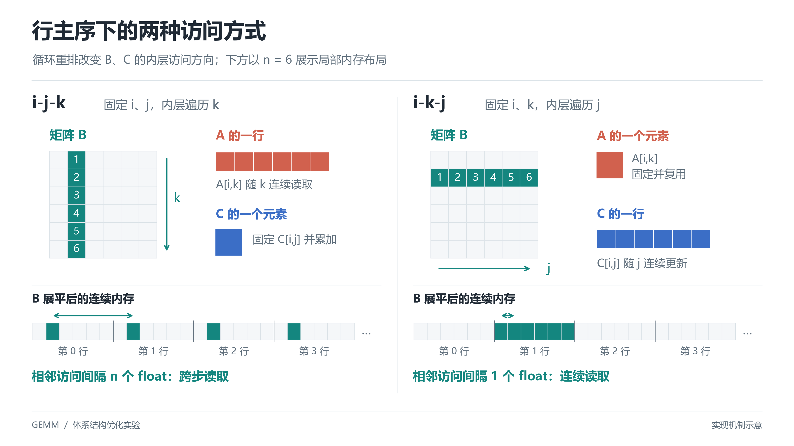
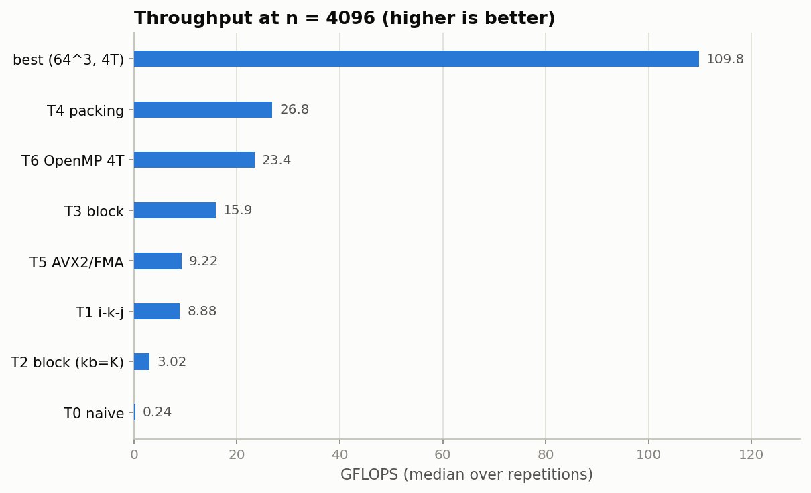
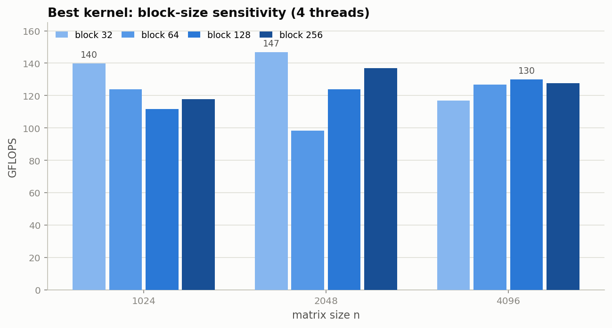

## 第 1 页｜封面

### 页面文字

基于计算机体系结构技术的矩阵乘法性能优化

2026 秋《高级计算机体系结构》实验汇报

汇报人：________　学号：________

日期：________

---

## 第 2 页｜目录

### 页面文字

一、调研报告

二、实验方案设计

三、实验指标

四、实验数据与分析

五、实验结论

---

## 第 3 页｜一、调研报告

---

## 第 4 页｜1.1 GEMM 问题与性能模型

### 页面文字

**GEMM 问题定义**　本实验计算两个按行存储的 $n\times n$ 单精度（FP32）方阵的乘积。

$$
C=AB,\qquad C_{ij}=\sum_{k=0}^{n-1} A_{ik}B_{kj}.
$$

- **计算量**　共 $n^3$ 次乘加，每次计 2 FLOP，故 $F=2n^3\ \mathrm{FLOP}$。
- **理想主存流量**　$A$、$B$ 各读一次，$C$ 写一次，每个 FP32 元素占 4 字节，故 $Q_{\mathrm{ideal}}=3n^2\times 4=12n^2\ \mathrm{B}$。
- **理想算术强度**　$I_{\mathrm{ideal}}=\dfrac{F}{Q_{\mathrm{ideal}}}=\dfrac{2n^3}{12n^2}=\dfrac{n}{6}\ \mathrm{FLOP/B}$。

**Roofline 性能上界**

$$
P\leq\min\!\left(P_{\mathrm{peak}},\,B_{\mathrm{mem}} I_{\mathrm{eff}}\right),
\qquad I_{\mathrm{eff}}=\frac{F}{Q_{\mathrm{actual}}}.
$$

$P_{\mathrm{peak}}$ 为峰值算力，$B_{\mathrm{mem}}$ 为可持续主存带宽，$Q_{\mathrm{actual}}$ 为实际主存流量。

### 图片

---

## 第 5 页｜1.2 体系结构优化技术

### 页面文字

| 类别 | 优化方法 | 本实验中的实现 |
| --- | --- | --- |
| **存储层次** | 循环重排 | T1 将 i-j-k 改为 i-k-j，使内层循环按行连续访问 B 和 C。 |
| | 缓存分块 | T2 仅沿 $i$、$j$ 分块，T3 再沿 $k$ 分块，使较小的 B 子块可在多行计算间复用。 |
| | 面板打包 | T4 和 best 将 A、B 的面板复制到连续缓冲区，供内层循环顺序读取。 |
| **指令级并行** | 8×8 寄存器微内核与多累加器 | T5 和 best 用 8 条独立累加链，使多条乘加指令可重叠执行。每条 AVX2/FMA 向量指令同时更新 8 个 FP32 元素。 |
| **线程级并行** | OpenMP 按行并行 | T6 将 C 的不同行分给不同线程，每个线程独立计算整行。 |
| | OpenMP 按列块并行 | best 将 C 的不同列块分给不同线程，每个线程独立写回自己的列块。 |

Tensor Core、AMX、SME 和混合精度仅作调研。

### 图片

---

## 第 6 页｜1.3 调研结论与实验假设

### 页面文字

**调研结论**

连续访问能更充分地利用每条缓存行，分块能让已载入的数据参与多次乘加。SIMD 可以同时计算多个元素，多核可以同时计算不同的输出块。

**实验假设**

- **H1**　将内层对 B 的访问由按列改为按行后，循环重排版 T1 会快于朴素基线 T0。
- **H2**　工作集超过 L3 后，三维分块 T3 相对 T1 的收益会增大。仅沿 $i$、$j$ 分块的 T2 可能比 T1 更慢。
- **H3**　打包面板并调整遍历顺序的 T4 会快于普通分块 T3。
- **H4**　独立 SIMD 微内核 T5 在小矩阵上吞吐较高，矩阵增大后吞吐会下降。
- **H5**　在本机 4 个物理核上，T6 从 1 线程增至 4 线程会加速，从 4 增至 8 线程的收益取决于矩阵规模。

---

## 第 7 页｜二、实验方案设计

---

## 第 8 页｜2.1 实验变体与对照

### 页面文字

| 分组 | 变体与实现 | 比较对象与目的 |
| --- | --- | --- |
| **累加优化路径** | **T0**　朴素 i-j-k | 作为所有变体的性能基线。 |
| | **T1**　i-k-j 循环重排 | 与 T0 比较，衡量按行访问 B 的收益。 |
| | **T3**　三维缓存分块 | 与 T1 比较，衡量缓存分块的收益。 |
| | **T4**　面板打包并调整遍历顺序 | 与 T3 比较，衡量两项改动的组合收益。 |
| | **best 单线程**　打包面板上的 8×8 SIMD 微内核 | 与 T4 比较，衡量引入微内核后的增益。 |
| | **best 四线程**　OpenMP 列块并行 | 与 best 单线程比较，衡量列块并行的收益。 |
| **独立对照** | **T2**　仅沿 $i$、$j$ 分块 | 与 T1 比较，检验保留完整 $k$ 维度时的分块效果。 |
| | **T5**　独立 8×8 SIMD 微内核 | 比较 T5 在不同矩阵规模下的吞吐，观察规模效应。 |
| | **T6**　OpenMP 行并行 | 以 T6 单线程为基准，比较 2、4、8 线程的加速比。 |

### 图片

---

## 第 9 页｜2.2 实验环境

### 页面文字

| 项目     | 实验配置                                                              |
| -------- | --------------------------------------------------------------------- |
| 系统     | WSL2，Ubuntu 22.04.5                                                  |
| CPU      | Intel Core i5-1155G7，4 个物理核、8 个逻辑线程                        |
| 缓存     | 每核 L1 数据缓存 48 KiB、L2 缓存 1.25 MiB，所有核心共享 8 MiB L3 缓存 |
| 内存     | WSL2 可见的总内存为 7.6 GiB                                           |
| 编译器   | GCC 11.4.0                                                            |
| 编译选项 | `-O3 -march=native -fopenmp -std=gnu11 -Wall -Wextra`               |

---

## 第 10 页｜2.3 实验流程

### 图片

---

## 第 11 页｜三、实验指标

---

## 第 12 页｜3.1 性能指标

### 页面文字

比较同一阶数 $n$ 的方阵。$t_{v,r}$ 表示实现 $v$ 第 $r$ 次运行的耗时（秒），$\tilde{t}_v$ 表示该实现的耗时中位数。

**绝对吞吐量**衡量每秒完成的浮点运算量，单位为 GFLOPS。每次运行单独计算吞吐量，再取中位数。

$$
P_v = \operatorname{median}_{r}\!\left(\frac{2n^3}{10^9\,t_{v,r}}\right)
$$

**相对 T0 加速比**衡量当前实现相对朴素基线 T0 快了多少倍。

$$
S_{\mathrm{T0}\to v} = \frac{\tilde{t}_{\mathrm{T0}}}{\tilde{t}_v}
$$

**逐层增量加速比**衡量沿优化路径从上一阶段 $u$ 进入当前阶段 $v$ 所获得的加速倍数。

$$
S_{u\to v} = \frac{\tilde{t}_u}{\tilde{t}_v}
$$

---

## 第 13 页｜3.2 正确性检验

### 页面文字

每次运行在首个计时调用后，将 FP32 输出 $C$ 与相同输入的双精度参考结果 $C^{\mathrm{ref}}$ 逐元素比较。

**最大绝对误差**衡量偏差最大的元素与参考值相差多少。

$$
E_{\mathrm{abs}}=\max_{i,j}\left|C_{ij}-C^{\mathrm{ref}}_{ij}\right|
$$

**最大归一化误差**按参考值的大小衡量偏差。分母至少取 1，避免接近零的参考值放大误差。

$$
E_{\mathrm{rel}}=\max_{i,j}\frac{\left|C_{ij}-C^{\mathrm{ref}}_{ij}\right|}{\max\!\left(1,\left|C^{\mathrm{ref}}_{ij}\right|\right)}
$$

**通过条件**采用随方阵阶数 $n$ 增长的经验阈值，其中 $\varepsilon_{\mathrm{FP32}}$ 为单精度机器精度。

$$
E_{\mathrm{rel}}\le n\,\varepsilon_{\mathrm{FP32}},\qquad \varepsilon_{\mathrm{FP32}}=2^{-23}
$$

---

## 第 14 页｜四、实验数据与分析

---

## 第 15 页｜4.1 4096 阶各变体吞吐

### 页面文字

- 主批次中，默认 best（64³、4 线程）达到 **109.77 GFLOPS**，朴素基线 T0 为 **0.240 GFLOPS**。
- T1 连续读取 B 的整行，达到 **8.883 GFLOPS**。T2 仅沿 $i$、$j$ 分块，降至 **3.016 GFLOPS**。
- T2 沿 $k$ 读取 4096 个短段，每段仅 256 B，段起点相隔 16 KiB。频繁跨页可能妨碍预取并增加 TLB 压力。

### 图片

---

## 第 16 页｜4.2 矩阵规模与绝对性能

### 页面文字

- 128 阶时，T5 用 8×8 微内核在寄存器中累加，以 **100.98 GFLOPS** 领先。
- 到 4096 阶，T5 仍需沿 $k$ 跨行读取 B，不同输出块还会重复读 B，吞吐降至 **9.22 GFLOPS**。
- best 用分块和打包复用面板，1024–4096 阶的吞吐保持在约 **108–110 GFLOPS**。

### 图片

---

## 第 17 页｜4.3 相对加速比与组合路径

### 页面文字

- 4096 阶时，T0 → T1 的循环重排带来最大单步加速（**36.94 倍**）。T3 沿 $k$ 分块复用 B，相对 T1 再加速 **1.79 倍**。
- T4 将面板打包与遍历顺序调整结合，相对 T3 加速 **1.68 倍**。best 单线程用 8×8 微内核在寄存器中累加，相对 T4 加速 **2.43 倍**。
- best 从 1 线程扩到 4 线程，按列块并行加速 **1.69 倍**。总耗时从 T0 的 571.525 s 降至 1.252 s，相对 T0 加速 **456.48 倍**。

### 图片

---

## 第 18 页｜4.4 OpenMP 线程扩展

### 页面文字

- 4096 阶时，以 T6 单线程为基准，4 线程加速 **2.62 倍**（效率 **66%**），8 线程加速 **2.36 倍**（效率 **29%**）。
- 本机有 4 个物理核，超线程共享执行资源，可能限制大矩阵的扩展。1024、2048 阶时，8 线程仍略快于 4 线程。

### 图片

---

## 第 19 页｜4.5 best 的分块参数扫描

### 页面文字

- 固定 4 线程，1024、2048 阶实测以 **32³** 块最快，4096 阶以 **128³** 块最快（**130.02 GFLOPS**）。
- 小块缩小缓存工作集，大块减少分块切换和 C 的读写次数，两者的权衡随矩阵规模变化。
- 4096 阶默认 64³ 在主批次和扫描批次分别为 **109.77、126.86 GFLOPS**，相差 **15.6%**。同一扫描批次内，128³ 比 64³ 快约 **2.5%**。

### 图片

---

## 第 20 页｜五、实验结论

---

## 第 21 页｜5.1 实验假设验证

### 页面文字

4096 阶时，默认 best（64³ 分块、4 线程）达到 **109.77 GFLOPS**，相对朴素基线 T0 加速 **456.48 倍**。

| 实验假设 | 判断 | 关键证据 |
| --- | --- | --- |
| H1 循环重排 | 支持 | T1 在全部七个规模均快于 T0，4096 阶加速 **36.94 倍**。 |
| H2 缓存分块 | 部分支持 | 1024 阶工作集已超过 L3，T3 仍略慢于 T1。4096 阶时 T3 相对 T1 加速 **1.79 倍**。T2 在各规模均慢于 T1。 |
| H3 面板打包 | 支持组合方案 | 4096 阶时 T4 相对 T3 加速 **1.68 倍**。这组对照同时引入了面板打包和遍历顺序调整。 |
| H4 独立 SIMD | 支持性能趋势 | T5 在 128 阶达到 **100.98 GFLOPS**，到 4096 阶降至 **9.22 GFLOPS**。 |
| H5 线程扩展 | 支持 | 相对 T6 单线程，4096 阶时 4、8 线程分别加速 **2.62 倍、2.36 倍**。在 1024、2048 阶，8 线程略快于 4 线程。 |

---

## 第 22 页｜5.2 实验结论与实验局限性

### 页面文字

**实验结论**　4096 阶时，循环重排带来的单步加速最大。叠加分块、打包、SIMD 和 4 线程并行后，默认 best 达到 **109.77 GFLOPS**，相对朴素基线 T0 加速 **456.48 倍**。

**实验局限性**　仅测单台 CPU 的 FP32 方阵。4096 阶默认配置的吞吐跨批次相差 **15.6%**，缓存与 TLB 瓶颈仍缺少硬件计数验证。
