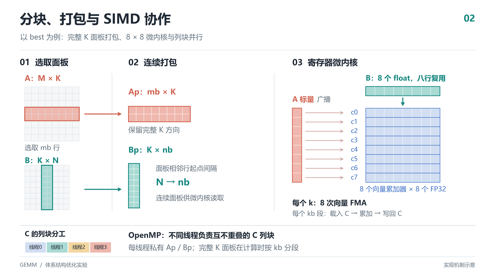
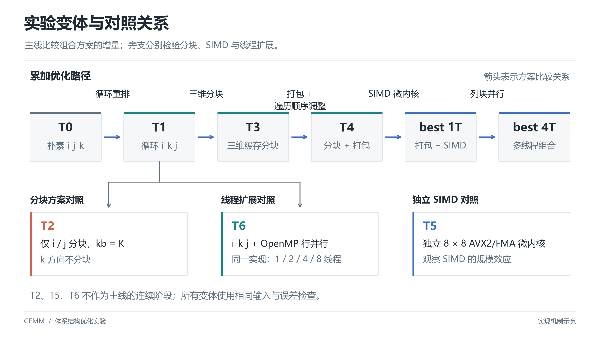
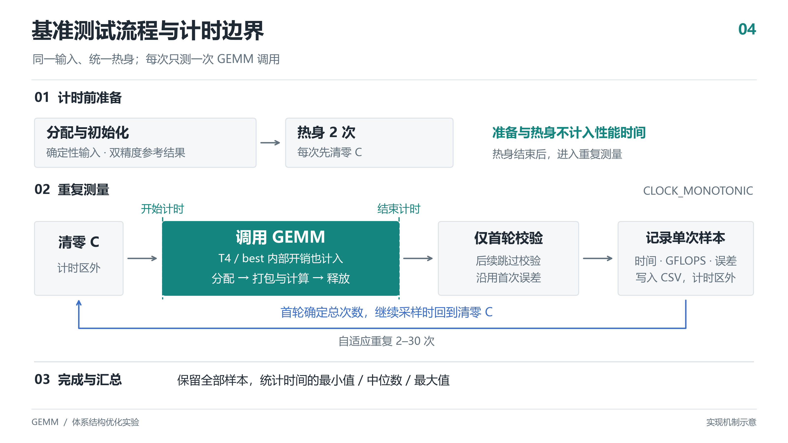
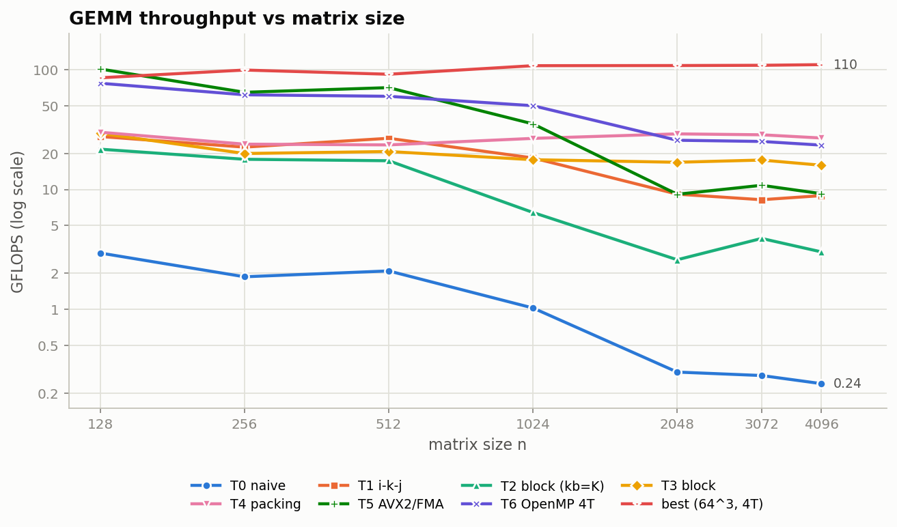
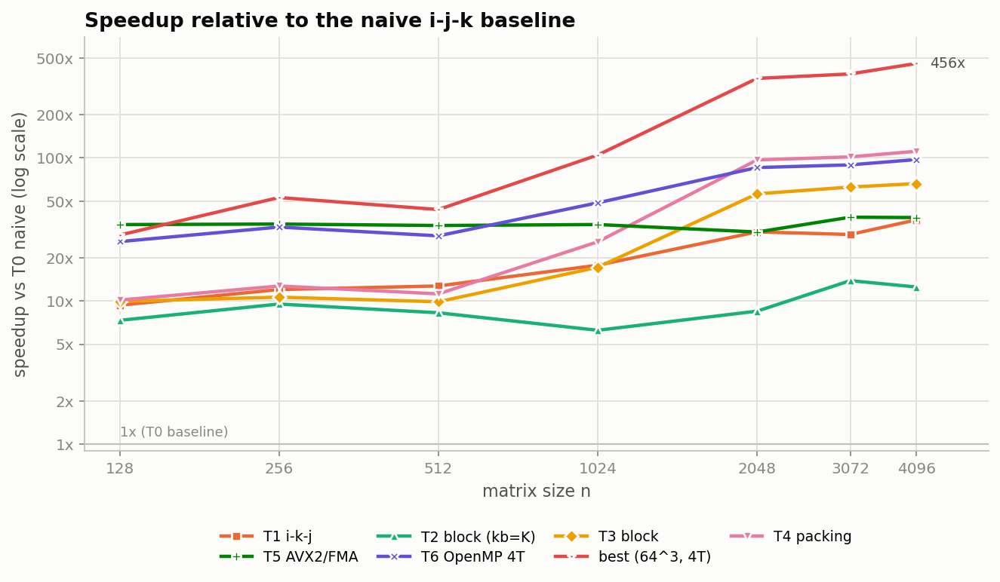

## 第 1 页｜封面

### 页面文字

基于计算机体系结构技术的矩阵乘法性能优化

2026 秋《高级计算机体系结构》实验汇报

汇报人：________　学号：________

日期：________

---

## 第 2 页｜目录

### 页面文字

一、调研报告

二、实验指标

三、实验方案设计

四、实验数据与分析

五、实验结论

---

## 第 3 页｜一、调研报告

---

## 第 4 页｜1.1 GEMM 问题与性能模型

### 页面文字

- 研究对象：行优先存储的 FP32 方阵乘法 C = A × B，计算量为 2n³ FLOP。
- A、B、C 的工作集共 12n² 字节。若 A、B 各从主存读取一次、C 写入一次，理想算术强度为 n/6 FLOP/Byte。
- 朴素 i-j-k 循环在内层沿 B 的列访问，相邻元素相隔 n 个 float；矩阵增大时，缓存行利用率下降。
- Roofline 上界为 min(峰值算力，有效算术强度 × 可持续带宽)。实际搬运量因实现而异，理想算术强度不能直接当作实测值。

### 图片

---

## 第 5 页｜1.2 体系结构优化技术

### 页面文字

| 优化层面 | 技术 | 作用 |
| --- | --- | --- |
| 存储层次 | 循环重排、缓存分块、数据打包 | 改善访问顺序与数据复用 |
| 指令级并行 | 8×8 寄存器分块、AVX2/FMA | 提高单核乘加吞吐 |
| 线程级并行 | OpenMP 划分 C 的行块或列块 | 利用多个物理核 |
| 调研范围 | Tensor Core、AMX、SME、混合精度等 | 仅讨论原理，不参与本机实测 |

本实验沿“访问顺序 → 缓存复用 → 连续面板 → 向量计算 → 多核并行”的路径构造对照。

### 图片

---

## 第 6 页｜1.3 调研结论与实验假设

### 页面文字

- H1：i-k-j 循环重排可让 B、C 的内层访问连续，显著改善朴素实现。
- H2：分块收益随工作集超过缓存容量而增大；不合适的块参数可能产生负收益。
- H3：打包方案提供连续面板，相对普通分块有望获得增量收益。
- H4：单独使用 SIMD 微内核可提高小矩阵吞吐，但难以解决大矩阵的重复访存。
- H5：4 线程更接近本机 4 个物理核；8 线程的收益取决于规模和共享资源。

---

## 第 7 页｜二、实验指标

---

## 第 8 页｜2.1 性能指标

### 页面文字

设 t_r 为单次计时，t 为同一配置的计时中位数，p 为线程数；各项加速比均在相同矩阵规模下计算。

| 指标 | 定义 | 回答的问题 |
| --- | --- | --- |
| 绝对吞吐 | 单次 GFLOPS = 2n³ / (t_r × 10⁹)；图表取各次 GFLOPS 的中位数 | 每秒完成多少浮点运算 |
| 相对 T0 加速比 | S_v = t_T0 / t_v | 相对朴素实现快多少 |
| 逐层增量加速比 | t_上一阶段 / t_当前阶段 | 新增优化阶段带来多少收益 |
| 并行效率 | E_p = (t_1T / t_pT) / p | 同一变体增加线程后扩展得如何 |

加速比按计时中位数计算，与图表的 GFLOPS 聚合口径略有不同。绝对吞吐与相对加速比需一起看：弱基线会放大相对倍数。

---

## 第 9 页｜2.2 正确性与测量质量

### 页面文字

- 用双精度参考结果校验 FP32 输出；记录最大绝对误差和最大相对误差。
- 最大相对误差按 |C − C_ref| / max(1，|C_ref|) 逐元素计算，再取最大值。
- 本实验采用经验阈值：最大相对误差 ≤ n × FLT_EPSILON；这不是严格的最坏误差上界。
- 每次 bench 运行在首个计时调用后校验一次，后续重复样本沿用该次误差记录。
- 汇总数据包含 16 个实验标签、1354 条测量记录；记录的误差字段与 GFLOPS 一致性均通过检查。最大相对误差为 1.374×10⁻⁴，最大阈值占比为 0.303。
- 保留全部重复计时样本，可计算最小值、中位数和最大值以观察波动；项目没有设置独立的“稳定性通过”阈值。

---

## 第 10 页｜三、实验方案设计

---

## 第 11 页｜3.1 实验变体与对照

### 页面文字

| 变体 | 实现 | 主要对照 |
| --- | --- | --- |
| T0 | 朴素 i-j-k | 性能基线 |
| T1 | i-k-j 循环重排 | 与 T0 比较访问顺序 |
| T2 | 仅 i/j 分块，k_b = K | 与 T1 比较不合适的分块 |
| T3 | 三维缓存分块 | 与 T1 比较分块方案 |
| T4 | 分块、面板打包 | 与 T3 比较方案增量 |
| T5 | 独立的 8×8 AVX2/FMA 微内核 | 观察单独 SIMD 的规模效应 |
| T6 | i-k-j 加 OpenMP 行并行 | 以同一实现的 1T 为线程基线 |
| best | 分块、打包、SIMD、OpenMP | 观察组合优化效果 |

T3、T4 与 best 构成累加优化路径；T5、T6 是独立对照变体。

### 图片

---

## 第 12 页｜3.2 实验环境与测量设计

### 页面文字

- 平台：WSL2 + Ubuntu 22.04.5；Intel Core i5-1155G7，4 个物理核、8 个逻辑线程，共享 L3 为 8 MiB。
- 工具链：GCC 11.4.0；统一编译选项为 -O3 -march=native -fopenmp -std=gnu11 -Wall -Wextra。
- 方阵规模：n = 128、256、512、1024、2048、3072、4096；另扫描 1/2/4/8 线程及 32³、64³、128³、256³ 分块。
- 各变体使用相同的确定性 A、B 输入和双精度参考；主矩阵分配、初始化及 C 清零均在计时区外。
- 使用 CLOCK_MONOTONIC；热身 2 次，自适应重复 2–30 次，以中位时间报告结果。T4 和 best 内部的打包缓冲分配与释放计入变体时间。
- 未采集完整 PMU 计数、实际内存带宽或真实运行频率；缓存与 TLB 的原因分析属于机制推断。

### 图片

---

## 第 13 页｜四、实验数据与分析

---

## 第 14 页｜4.1 4096 阶各变体吞吐

### 页面文字

- 朴素 T0：571.525 s、0.240 GFLOPS；默认 best（64³、4 线程）：1.252 s、109.773 GFLOPS，相对 T0 为 456.48 倍。
- 循环重排 T1 达到 8.883 GFLOPS；不合适的 T2 分块仅 3.016 GFLOPS，低于 T1。
- T3、T4、T5、T6 与 best 是不同方案或组合阶段；相对 T0 的倍数不等于某一项技术的独立贡献。

### 图片

---

## 第 15 页｜4.2 矩阵规模与绝对性能

### 页面文字

- n = 128 时，独立 T5 为 100.98 GFLOPS，高于默认 best 的 85.30 GFLOPS；n = 256、512 时，best 已反超 T5。
- T5 在 n = 4096 降至 9.22 GFLOPS；默认 best 在 n = 1024–4096 的实测范围为 107.61–109.77 GFLOPS。
- 三矩阵工作集在 n = 1024 时为 12 MiB，超过本机 8 MiB L3；这提供容量线索，但没有缓存缺失计数来直接证明瓶颈。

### 图片

---

## 第 16 页｜4.3 相对加速比与组合路径

### 页面文字

- n = 4096 的累加路径（中位时间）：T0 571.525 s → T1 15.472 s → T3 8.638 s → T4 5.136 s → best 1T 2.113 s → best 4T 1.252 s。
- 逐层增量加速比约为 36.94、1.79、1.68、2.43、1.69 倍；最终相对 T0 为 456.48 倍。
- T4 相比 T3 还改变了外层遍历顺序，1.68 倍代表整个 T4 方案的增量，不能严格归因于“只做打包”。
- T0 在大矩阵上退化明显；阅读相对加速比时，应同时看上一页的绝对吞吐。

### 图片

---

## 第 17 页｜4.4 OpenMP 线程扩展

### 页面文字

- 对同一个 T6 实现，在 n = 4096 时，4 线程相对 1 线程加速 2.62 倍，并行效率 0.66。
- 8 线程在该规模加速 2.36 倍，效率 0.29；但在 n = 1024、2048 时，8 线程的绝对吞吐略高于 4 线程。
- 超线程不增加物理 FMA 执行单元；共享缓存、带宽和频率可能影响扩展，本实验未直接测量这些硬件事件。

### 图片

---

## 第 18 页｜4.5 best 的分块参数扫描

### 页面文字

| 矩阵规模 | 本组最好观测块大小 | GFLOPS |
| --- | --- | ---: |
| n = 1024 | 32³ | 139.92 |
| n = 2048 | 32³ | 146.80 |
| n = 4096 | 128³ | 130.02 |

- 64³、4 线程是项目采用的固定默认配置；扫描仅覆盖三个规模，不能据此证明它在全规模最优。
- n = 4096 的 128³ 结果来自探索性测量，批次间存在波动，参数排序需要独立复核。

### 图片

---

## 第 19 页｜五、实验结论

---

## 第 20 页｜5.1 对研究问题的回答

### 页面文字

- 单项与阶段收益：循环重排是最直接的一步；不合适的分块会变慢；分块、打包方案和微内核组合后继续提升吞吐。
- 规模影响：n = 128 时独立 SIMD 最快；从 n = 256 起，本组测试中的 best 组合领先。缓存与带宽解释由工作集和访问模式推断。
- 组合效果：固定默认配置在 n = 4096 达到 109.773 GFLOPS，相对 T0 为 456.48 倍；128³ 的 130.02 GFLOPS 是探索性最好观测值。

---

## 第 21 页｜5.2 局限与后续工作

### 页面文字

- 本实验只测单台 CPU 上的 FP32 方阵，没有 OpenBLAS 对照；结果不代表与工业 GEMM 库的性能差距。
- 缺少完整 PMU、实际带宽和真实频率数据，无法把缓存、TLB 或全核降频确定为已测得的瓶颈。
- 大矩阵部分配置只有 2–3 次重复，且存在批次波动；下一步应做独立批次复测并展示离散度。
- 可进一步测试矩形矩阵、缓冲区预分配、线程亲和与 OpenBLAS 对照，明确各优化在不同场景下的收益。
