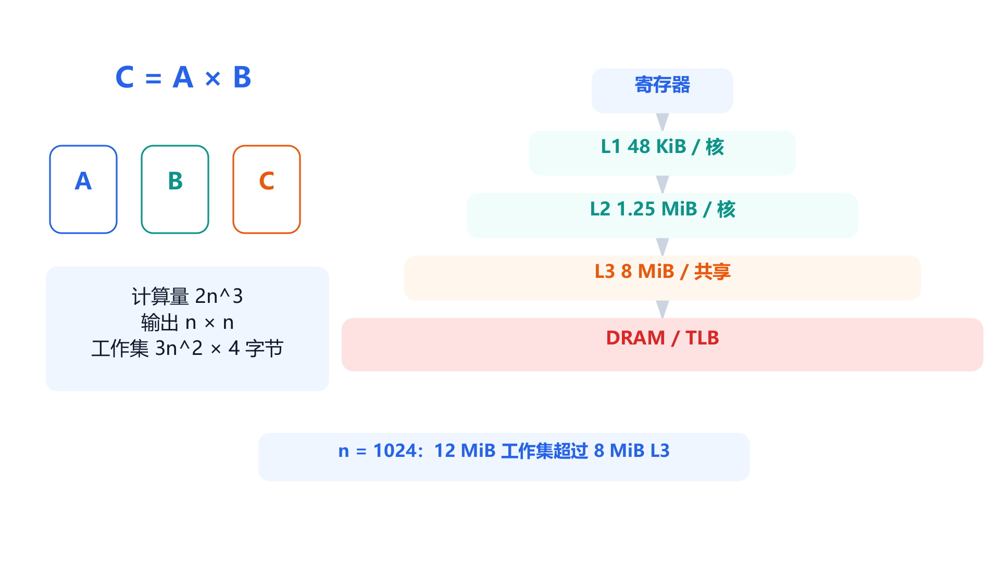
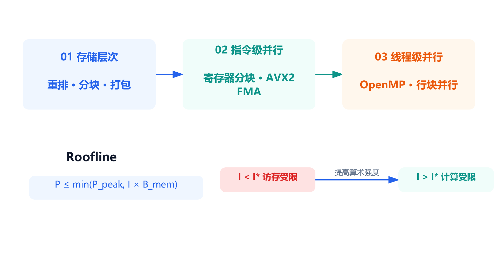
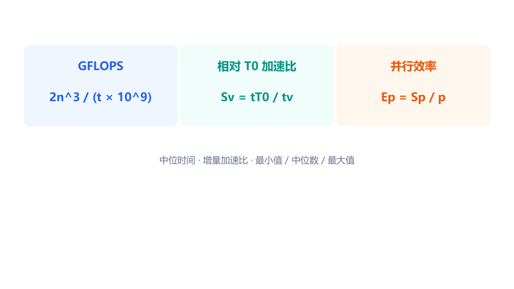
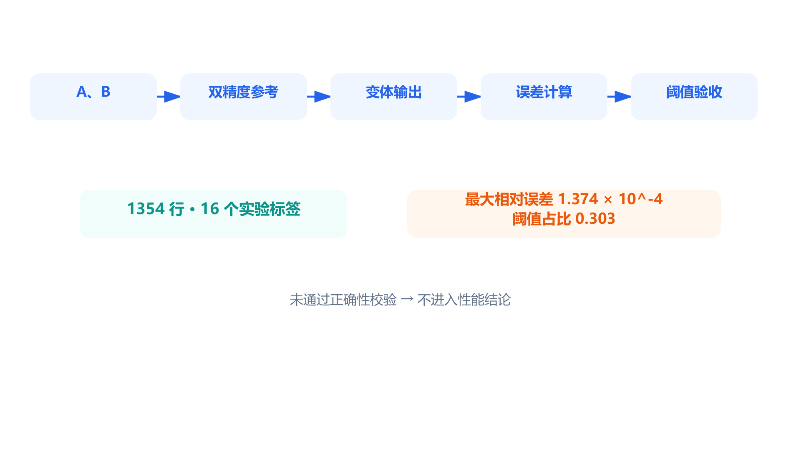
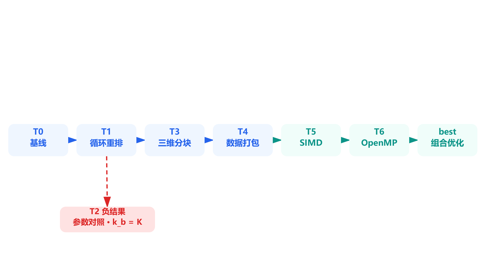
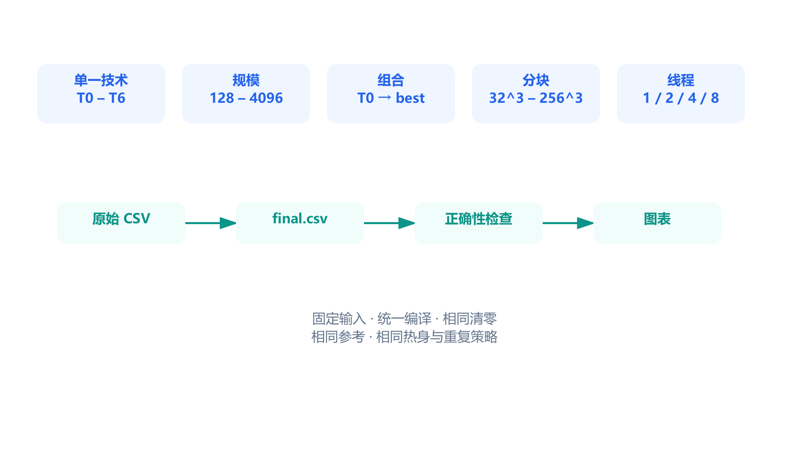
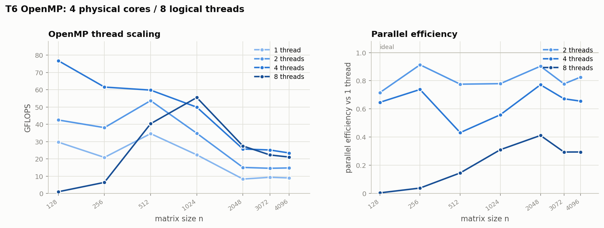

答辩 PPT 逐页内容稿

建议 15 页，16:9，讲演 10–12 分钟，现场演示 3–5 分钟。整体按“调研报告 → 指标 → 方案 → 数据与分析 → 结论”组织。五张结果图集中在第 10–14 页，每张只出现一次。

---

## 第 1 页｜封面

### 页面文字

基于计算机体系结构技术的矩阵乘法性能优化

副标题：实验汇报

姓名：____________________
学号：____________________
课程：2026 秋《高级计算机体系结构》
日期：2026-11-15

### 版式

纯文字封面，标题居中，个人信息放在下方。

### 讲稿

本次汇报围绕 GEMM 的访存瓶颈，介绍调研背景、评价指标、方案设计、数据和结论。

---

## 第 2 页｜汇报目录

### 页面文字

1. 调研报告
2. 实验指标
3. 实验方案设计
4. 实验数据与分析
5. 实验结论

一句话概括：

> 本次汇报回答三个问题：单项技术有多少收益、规模如何影响结果、组合优化能达到什么性能。

### 版式

用一条横向流程展示五个部分，当前章节用高亮色标识。

### 讲稿

汇报先介绍 GEMM 的体系结构背景和调研结论，再说明指标和实验设计，最后集中展示数据并得出结论。

---

## 第 3 页｜1.1 GEMM 问题与性能模型

### 页面文字

- GEMM：C = A × B，行优先 FP32 方阵。
- 计算量为 2n³，理想算术强度为 n/6 FLOP/Byte。
- 三个矩阵的工作集为 3n² × 4 字节。
- 朴素 i-j-k 中，B 的访问步长为 n，缓存行利用率低。
- 矩阵规模增大后，工作集依次离开 L2、L3 和 DRAM。

### 配图

图片放在右侧约 60% 区域，左侧保留本页文字要点。

### 一句话结论

GEMM 的主要瓶颈是数据复用不足，而不是乘加指令数量。

### 讲稿

调研从计算量、访存量和存储层次出发，说明 GEMM 为什么会从计算受限转为缓存、带宽或 TLB 受限。

---

## 第 4 页｜1.2 体系结构优化技术

### 页面文字

| 层面       | 代表技术                                 | 本实验处理    |
| ---------- | ---------------------------------------- | ------------- |
| 存储层次   | 循环重排、缓存分块、数据打包、寄存器分块 | 实测          |
| 指令级并行 | SIMD、FMA、多累加器、循环展开            | 实测 SIMD/FMA |
| 线程级并行 | OpenMP、行/列块划分、共享缓存、带宽      | 实测 OpenMP   |
| 专用架构   | Tensor Core、Intel AMX、ARM SME          | 仅调研        |
| 算法与数值 | Strassen、混合精度、稀疏算法             | 仅调研        |
| 工具链     | BLAS/BLIS、经验搜索、自动调优            | 背景与展望    |

### 版式

表格占页面主体，左侧每类技术前放一个统一编号，右侧用“实测 / 仅调研 / 背景”标记实验范围。

### 一句话结论

调研覆盖六类优化技术，实验只落地本机可复现的 CPU 部分。

### 讲稿

存储、指令和线程并行与实验直接相关；Tensor Core、AMX、SME、低精度和稀疏算法受平台限制，只作为背景和后续工作。

---

## 第 5 页｜1.3 调研结论与实验假设

### 页面文字

- 优化路径：改善访问顺序 → 控制工作集 → 连续化布局 → 单核算力 → 多核并行。
- H1：循环重排会显著改善 B、C 连续性。
- H2：分块收益在超过 L3 后明显增加。
- H3：数据打包会为 SIMD 提供连续面板。
- H4：单独 SIMD 无法解决大矩阵访存问题。
- H5：4 线程接近物理核上限，8 线程受共享资源限制。

### 配图

图片放在右侧，突出“存储层次、指令并行、线程并行”三层路线；Roofline 示意位于下半部分。

### 一句话结论

调研结论转化为五个可验证假设，并落实到 T0–T6 与 best 的变体设计。

### 讲稿

后面的结果会逐项回应 H1–H5，而不是只报告几个加速比。尤其是 T2 负结果、T5 的规模退化和 4/8 线程差异，分别用于检验这些假设。

---

## 第 6 页｜2.1 性能指标

### 页面文字

绝对吞吐：

$$
\mathrm{GFLOPS}=\frac{2n^3}{t\times10^9}
$$

相对朴素基线加速比：

$$
S_v=\frac{t_{T0}}{t_v}
$$

并行效率：

$$
E_p=\frac{S_p}{p}
$$

补充指标：中位执行时间、相对上一层的增量加速比。

### 配图

图片放在页面下半部分，上方放本页文字；如 PowerPoint 支持，可将公式重新做成原生公式对象。

### 一句话结论

性能需要同时用绝对吞吐、相对加速比和并行效率描述。

### 讲稿

GFLOPS 衡量单位时间完成的浮点运算，加速比衡量优化收益，并行效率衡量多线程扩展性。

---

## 第 7 页｜2.2 正确性与稳定性指标

### 页面文字

最大绝对误差：

$$
\mathrm{maxAbsErr}=\max_{i,j}\left|C_{ij}-C_{ij}^{\mathrm{ref}}\right|
$$

最大相对误差：

$$
\mathrm{maxRelErr}
=\max_{i,j}\frac{\left|C_{ij}-C_{ij}^{\mathrm{ref}}\right|}
{\max\left(1,\left|C_{ij}^{\mathrm{ref}}\right|\right)}
$$

- 验收阈值：n × FLT-EPSILON。
- 数据规模：1354 行、16 个标签。
- 最大相对误差：1.374 × 10⁻⁴。
- 最大阈值占比：0.303。

### 配图

图片放在右侧约 60% 区域，左侧保留误差公式和验收阈值。

### 一句话结论

所有性能结论都建立在正确性和测量稳定性检查之上。

### 讲稿

每个变体先与双精度参考结果比较。报告采用中位数，同时保留最小值、最大值和重复样本。

---

## 第 8 页｜3.1 实验变体

### 页面文字

| 变体 | 技术                        | 验证内容   |
| ---- | --------------------------- | ---------- |
| T0   | 朴素 i-j-k                  | 基线       |
| T1   | i-k-j 循环重排              | 访问连续性 |
| T2   | 不合理 i/j 分块             | 负结果     |
| T3   | 64³ 三维分块               | 缓存容量   |
| T4   | 分块 + 数据打包             | 数据布局   |
| T5   | 8×8 AVX2/FMA               | 单核算力   |
| T6   | OpenMP 1/2/4/8 线程         | 线程扩展   |
| best | 分块 + 打包 + SIMD + OpenMP | 组合优化   |

### 配图

图片放在页面下半部分，上方保留变体表的核心行。

### 一句话结论

实验既保留负结果，也单独评估 SIMD 和多线程的边界。

### 讲稿

T2 用于说明分块参数不合理时的后果，T5 用于观察单独 SIMD 的效果，best 代表完整组合方案。

---

## 第 9 页｜3.2 实验矩阵与控制变量

### 页面文字

| 实验     | 变化量                   |
| -------- | ------------------------ |
| 单一技术 | T0–T6                   |
| 规模扫描 | 128–4096                |
| 组合优化 | T0 → best               |
| 分块扫描 | 32³、64³、128³、256³ |
| 线程扫描 | 1、2、4、8 线程          |

控制变量：同一份 A、B；相同编译选项；相同清零方式；相同双精度参考；相同热身和重复策略。

### 配图

图片占页面右侧约 60% 区域，左侧保留控制变量清单。

### 一句话结论

统一输入、编译和测量协议保证不同变体可以公平比较。

### 讲稿

实验统一采用 beta = 0，C 在计时区外清零；主矩阵分配和初始化不计时。

---

## 第 10 页｜4.1 单一技术结果

### 页面文字

- T1 循环重排：36.94 倍。
- T2 不合理分块：12.54 倍，低于 T1。
- T3 三维分块：66.17 倍。
- T4 分块 + 打包：111.28 倍。
- T5 仅 SIMD：38.31 倍。
- T6 OpenMP 4T：97.37 倍。

以上均为 n = 4096 相对 T0。

### 配图

图片占页面右侧约 55%，左侧放关键结果表。

### 一句话结论

循环重排收益最直接，组合技术进一步放大优化效果。

### 讲稿

T2 说明分块不是无条件有效。T4、T5 和 T6 分别验证了打包、SIMD 和多线程的潜力。

---

## 第 11 页｜4.2 矩阵规模影响

### 页面文字

- n = 128：工作集 192 KiB，主要位于 L2。
- n = 512：工作集 3 MiB，进入 L3。
- n = 1024：工作集 12 MiB，超过 8 MiB L3。
- n ≥ 2048：DRAM、TLB 和共享带宽压力增大。
- T5 从 100.98 降到 9.22 GFLOPS。
- best 在中大矩阵保持约 108–110 GFLOPS。

### 配图

完整曲线放在右侧，用竖线标出 n = 1024 的 L3 转折。

### 一句话结论

矩阵规模改变主导瓶颈，也改变优化技术是否有效。

### 讲稿

小矩阵重点是减少线程开销；超过 L3 后分块和打包才明显有效；大矩阵受到 DRAM、TLB 和共享带宽限制。

---

## 第 12 页｜4.3 400 多倍加速比解释

### 页面文字

- T0 在 n = 4096 只有 0.240 GFLOPS。
- best 为 109.77 GFLOPS，相对 T0 为 456.48 倍。
- 4 核 AVX2 理论峰值为 320–576 GFLOPS。
- best 约为 2.5 GHz 峰值的 34%。
- 按当前 T0 固定，绝对上限约为 1331–2395 倍。
- 按 Roofline 分别估计，合理范围约为 205–737 倍。

### 配图

右侧放加速比曲线，左侧底部加一条简化 Roofline 示意线。

### 一句话结论

400 多倍是相对低效朴素基线的结果，在 Roofline 上界内成立。

### 讲稿

该结果不能与 OpenBLAS 直接比较。朴素基线的跨步访问非常严重，因此优化空间很大。

---

## 第 13 页｜4.4 OpenMP 线程扩展

### 页面文字

- n = 2048：4 线程加速 3.09 倍，效率 0.77。
- n = 4096：4 线程加速 2.62 倍，效率 0.66。
- 8 线程在 n = 4096 只有 2.36 倍，效率 0.29。
- n = 128 的 8 线程存在明显启动开销和测量波动。
- 4 个物理核比 8 个逻辑线程更能代表计算上限。

### 配图

左右两张子图分别展示 GFLOPS 和并行效率。

### 一句话结论

4 线程是本平台更稳健的并行配置。

### 讲稿

多线程受到共享 L3、DRAM 带宽和全核频率限制。超线程不能提供额外的 FMA 吞吐。

---

## 第 14 页｜4.5 组合优化与参数扫描

### 页面文字

- 累加栈：T0 → T1 → T3 → T4 → best 1T → best 4T。
- 1024–2048：32³ 分块更合适。
- 4096：128³ 分块观测到 130.02 GFLOPS。
- 小矩阵：T5 单线程优于多线程组合。
- 64³/4T 是全规模默认选择。

### 配图

右侧放分块柱状图，左侧用箭头表示累加优化栈。

### 一句话结论

最佳配置是矩阵规模和线程预算的函数。

### 讲稿

128³ 的 540.68 倍是探索性最好观测值；64³/4T 在整个规模范围内更稳健。

---

## 第 15 页｜5 实验结论

### 页面文字

1. 循环重排解决最严重的跨步访问。
2. 分块必须匹配工作集和访问布局。
3. 打包是分块与 SIMD 之间的桥梁。
4. SIMD 不能单独解决大矩阵。
5. 4 线程比 8 线程更稳健。
6. 默认 best 64³/4T 达到 109.77 GFLOPS、456.48 倍。

现场演示：编译 → 运行 T0 与 best → 校验数据 → 展示结果图。

### 版式

六条结论使用两列卡片排列，底部单独放一行演示步骤，不放结果图。

### 一句话结论

GEMM 优化需要让数据复用、指令并行和线程并行同时匹配存储层次。

### 讲稿

本次实验不仅得到最高加速比，还说明了每项技术为什么有效、在什么规模有效，以及如何组合成稳定方案。
