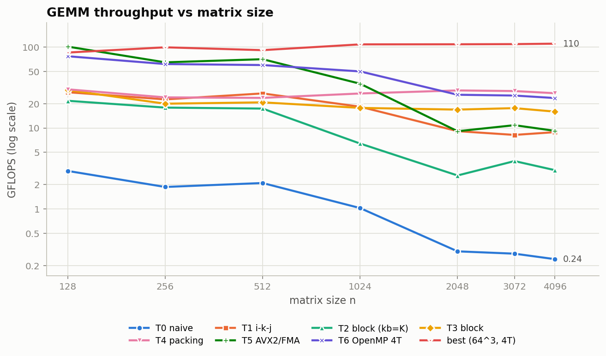
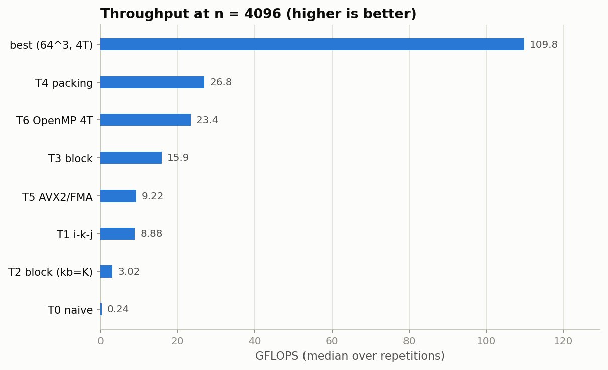
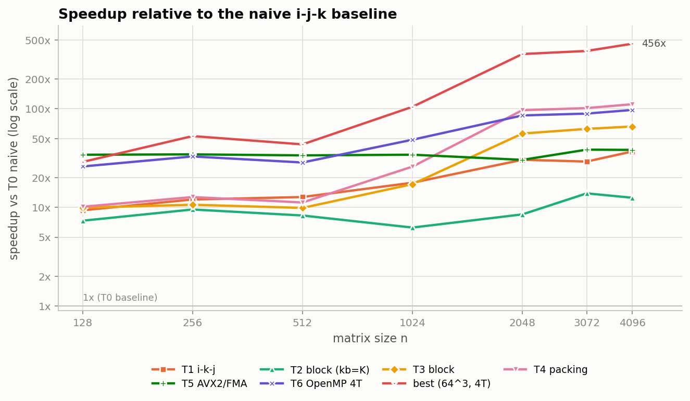
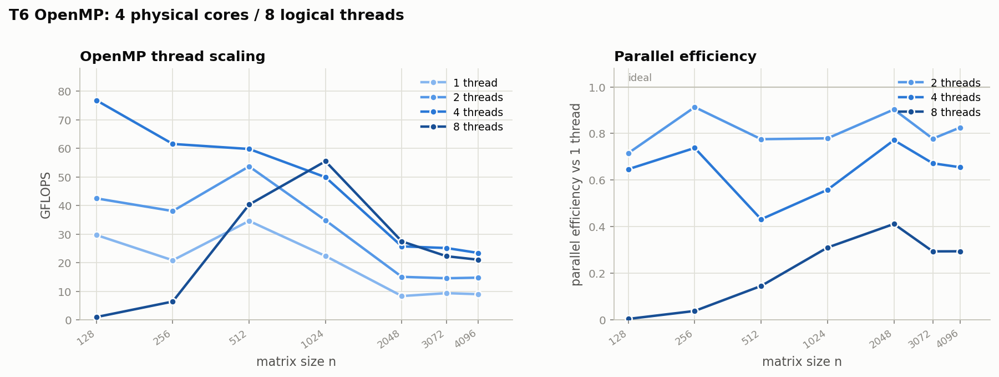
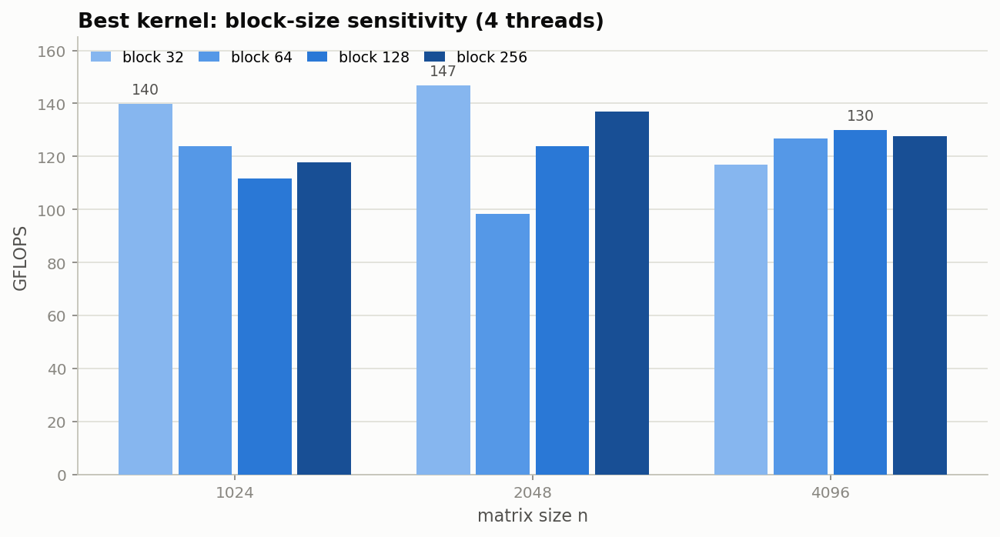

# 基于计算机体系结构技术的矩阵乘法性能优化

## 调研与实验报告

课程：2026 秋《高级计算机体系结构》

姓名：____________________
学号：____________________
日期：2026-11-14

---

## 摘要

本报告研究循环重排、缓存分块、数据打包、SIMD 微内核和多线程对 FP32 方阵 GEMM 性能的影响。实验在 Intel i5-1155G7 平台实现 T0–T6 和组合优化版本，覆盖 n = 128 到 4096。

结果表明，循环重排能够直接改善最严重的跨步访问；分块必须与工作集和访问布局匹配；打包与 SIMD 需要协同使用；多线程收益受共享缓存和带宽限制。默认组合配置 64³、4 线程在 n = 4096 达到 109.77 GFLOPS，相对朴素基线加速 456.48 倍。全部 1354 行实验数据均通过正确性和 GFLOPS 一致性检查。

关键词：GEMM；缓存分块；数据打包；SIMD；OpenMP；Roofline

## 目录

第一部分：调研报告

1. GEMM 问题与性能模型
2. 体系结构优化技术
3. 调研结论与实验假设

第二部分：实验报告

4. 实验目标与设计
5. 实验环境与测量方法
6. 实验结果与分析
7. 实验结论

附录 A：全规模 GFLOPS 与加速比
附录 B：数据质量与复现说明

---

# 第一部分 调研报告

## 1 GEMM 问题与性能模型

### 1.1 GEMM 定义与计算访存特征

行优先方阵 GEMM 定义为：

$$
C_{ij}=\sum_{k=0}^{K-1}A_{ik}B_{kj},
\qquad C_{n\times n}=A_{n\times n}B_{n\times n}.
$$

一次乘加计 2 次浮点运算，因此计算量为 2n³。对朴素 i-j-k 实现，最内层对 k 归约，访问 B[k × n + j] 的步长为 n 个 float。固定一个输出元素时，A 的行可以连续读取，但 B 的列会跨越 n 行内存；当 n 较大时，每次内层迭代都可能访问新的缓存行。

若三个矩阵都只从主存读取一次，理想访存量为 4 × 3n² = 12n² 字节，算术强度为：

$$
I=\frac{2n^3}{12n^2}=\frac{n}{6}\ \text{FLOP/Byte}.
$$

理想算术强度随 n 增长，但工作集 3n² × 4 字节同步扩大。实际实现的重复读取和跨步访问会降低有效算术强度，使程序从计算受限转向缓存、带宽或 TLB 受限。

### 1.2 Roofline 与存储层次

Roofline 模型给出可达性能上界：

$$
P_{\text{attainable}}\leq\min\left(P_{\text{peak}},I\cdot B_{\text{mem}}\right)
$$

其中 P_peak 为峰值浮点性能，B_mem 为可持续内存带宽。当算术强度较低时，增加 SIMD 或多线程不能突破访存上界；只有通过分块和打包提高数据复用，才能把程序推向计算受限区域。

|    n | 三矩阵工作集 | 主要容量区间      |
| ---: | -----------: | ----------------- |
|  128 |      192 KiB | L2                |
|  512 |        3 MiB | L3                |
| 1024 |       12 MiB | 超出本机 8 MiB L3 |
| 4096 |      192 MiB | DRAM/TLB          |

因此，GEMM 优化的核心不是增加乘加语句，而是提高寄存器、缓存和主存之间的数据复用。GEMM 的 I/O 复杂度下界 Ω(n³ / √S) 说明，快速存储容量 S 越大，理论最优访存代价越低。

## 2 体系结构优化技术

### 2.1 存储层次优化

循环顺序决定最内层访问是否连续。行优先布局下，i-k-j 通常优于 i-j-k，因为 B 和 C 都可以按行连续访问。

缓存分块把矩阵划分为适合 L1/L2/L3 的子块，使一个 A 行块和 B 列块在被替换前服务多个 C 元素。分块参数必须匹配缓存容量、相联度和边界开销；块太小会降低复用，块太大则工作集溢出。

数据打包把非连续面板复制到连续、对齐的临时区域，便于顺序读取和 SIMD 载入。按本实验实现，B 面板每个列块打包一次，流量约为 O(n²)；A 面板随每个列块重复打包，流量约为 O(n³ / n_b)。打包的主要价值不是复制本身，而是为后续多次复用和向量化准备布局。

寄存器分块让一个线程同时维护多个 C 元素，使一次载入的 A、B 元素被多个乘加复用。微内核形状受寄存器数量、SIMD 宽度和指令延迟共同约束。

### 2.2 指令级并行

AVX2 的 256 位寄存器包含 8 个 FP32 lane。8×8 微内核使用 8 个累加向量，每次载入 B 的 8 个元素并广播 8 个 A 元素，可显著提高单核乘加密度。FMA 将乘法和加法合并为一条指令，多累加器则提供独立依赖链以隐藏延迟。

SIMD 需要连续、对齐的数据。如果 B 仍然跨步行访问，向量载入无法充分利用缓存行，寄存器分块也可能被访存延迟拖住。因此 SIMD 与打包、分块是强耦合关系。

### 2.3 线程级并行

GEMM 可以按 C 的行或列块并行。行块并行实现简单，每个线程写不同的 C 行；列块并行便于共享 A 面板；二维块划分可以兼顾负载均衡和缓存复用。

多线程收益受共享 L3、DRAM 带宽、全核频率和线程启动开销限制。物理核数通常比逻辑线程数更能代表计算吞吐上限，8 个逻辑线程共享 4 个物理核时，超线程不会带来线性加速。

### 2.4 专用架构与适用范围

NVIDIA Tensor Core、Intel AMX 和 ARM SME 均通过矩阵 tile、fragment 或二维累加器减少指令开销，提高矩阵乘加吞吐。Google TPU 的脉动阵列通过规则数据流提高能效。

本机是 Tiger Lake 客户端 CPU，支持 AVX2/FMA 和 AVX-512，但没有 AMX、SME 或 NVIDIA GPU。因此这些技术只用于调研和展望，不参与本机加速比。混合精度、FP8、稀疏算法和 Strassen 同样不属于本次实测范围。

### 2.5 工具链与自动调优

BLAS 提供统一的 GEMM 接口，使上层程序不依赖具体微内核。经验式自动调优通过生成候选内核并实测选择参数，说明性能参数依赖具体微架构。更现代的方法使用搜索和代价模型自动生成高性能调度。本实验不引入自动调优框架，而是通过手工扫描分块和线程数验证参数敏感性。

## 3 调研结论与实验假设

调研表明，GEMM 的优化应沿着“改善访问顺序 → 控制工作集 → 连续化数据布局 → 提高单核算力 → 利用多核”推进。结合本机能力，实验选择循环重排、三级分块、数据打包、AVX2/FMA 微内核和 OpenMP。

由此提出五个待验证假设：

- H1：i-k-j 重排会显著改善 B、C 的顺序访问，是收益最直接的单步优化。
- H2：分块收益应在工作集超过 L3 后明显增加，不合理的块参数可能产生负收益。
- H3：数据打包会为 SIMD 提供连续面板，并相对三级分块产生稳定增量收益。
- H4：单独 SIMD 在小矩阵有效，但没有分块和打包时无法解决大矩阵访存问题。
- H5：4 线程会接近物理核扩展上限，8 线程受共享资源和线程开销限制。

---

# 第二部分 实验报告

## 4 实验目标与设计

### 4.1 研究问题

- RQ1：循环重排、分块、打包、SIMD 和多线程各自能带来多少收益，原因是什么？
- RQ2：矩阵规模如何改变缓存、访存和并行瓶颈？
- RQ3：多技术组合的收益、最佳配置和限制是什么？

### 4.2 变体设计

| 变体 | 技术                          | 主要验证目标         |
| ---- | ----------------------------- | -------------------- |
| T0   | 朴素 i-j-k                    | 建立性能和正确性基线 |
| T1   | i-k-j 循环重排                | H1                   |
| T2   | 仅 i/j 分块，k_b = K          | H2 的负结果对照      |
| T3   | 64³ 三维分块                 | H2                   |
| T4   | 分块 + A/B 面板打包           | H3                   |
| T5   | 8×8 寄存器分块 + AVX2/FMA    | H4                   |
| T6   | OpenMP 行并行                 | H5                   |
| best | 分块 + 打包 + 微内核 + OpenMP | RQ3                  |

### 4.3 实验矩阵

主要扫描 n ∈ {128, 256, 512, 1024, 2048, 3072, 4096}。

| 实验     | 自变量                       | 主要观测               |
| -------- | ---------------------------- | ---------------------- |
| 单一技术 | T0–T6                       | GFLOPS、加速比、误差   |
| 规模扫描 | n                            | 工作集、拐点、绝对吞吐 |
| 组合优化 | T0 → T1 → T3 → T4 → best | 总收益和增量收益       |
| 分块扫描 | 32³、64³、128³、256³     | 块大小敏感性           |
| 线程扫描 | 1、2、4、8 线程              | 强扩展和并行效率       |

### 4.4 控制变量与正确性

所有变体使用同一份 A、B 输入、相同编译选项、相同基准程序和相同双精度参考结果。每次调用前由基准程序在计时区外将 C 清零，统一采用 beta = 0 语义。

验收阈值为：

$$
\mathrm{relErr}\leq n\cdot\mathrm{FLT-EPSILON},\qquad
\mathrm{FLT-EPSILON}\approx1.19\times10^{-7}.
$$

该阈值是结合输入范围和累加长度设置的经验判据，不是与输入无关的严格最坏误差上界。

## 5 实验环境与测量方法

### 5.1 实验平台

| 项目     | 配置                                                |
| -------- | --------------------------------------------------- |
| 系统     | WSL2 + Ubuntu 22.04.5                               |
| CPU      | Intel Core i5-1155G7，4 物理核 / 8 逻辑线程         |
| 缓存     | L1d 48 KiB/核，L2 1.25 MiB/核，L3 8 MiB             |
| 内存     | WSL 可见 7.6 GiB                                    |
| 编译器   | GCC 11.4.0                                          |
| 编译选项 | -O3 -march=native -fopenmp -std=gnu11 -Wall -Wextra |

### 5.2 实现路线与数据流程

所有变体实现统一函数接口，基准程序通过函数指针选择 T0–T6 或 best。测量结果先写入各实验批次 CSV，再由合并脚本增加唯一实验标签，随后执行正确性检查和绘图。

T4 和 best 的计时包含面板打包、临时缓冲区分配/释放和 OpenMP 运行开销。主矩阵 A、B、C 的分配、初始化和 C 清零不计时。因此 T4/best 反映完整变体调用成本，小矩阵上分配和线程启动开销的影响更大。

### 5.3 测量协议

计时使用 CLOCK_MONOTONIC，默认热身 2 次。每次测量只包围一次 GEMM 调用；重复次数自适应，最少 3 次，单次超过 2 秒时最少 2 次，最多 30 次。报告采用中位数，并保留最小值、最大值和全部重复样本用于稳定性分析。

本机未采集完整 PMU 缓存/TLB 计数，WSL 无法读取真实频率和温度，也未固定 governor 和绑核。因此缓存、TLB 和带宽结论属于基于工作集与访问模式的机制分析。

### 5.4 正确性验证

最大绝对误差和最大相对误差为：

$$
\mathrm{maxAbsErr}=\max_{i,j}\left|C_{ij}-C_{ij}^{\text{ref}}\right|,
$$

$$
\mathrm{maxRelErr}
=\max_{i,j}\frac{\left|C_{ij}-C_{ij}^{\text{ref}}\right|}
{\max\left(1,\left|C_{ij}^{\text{ref}}\right|\right)}.
$$

全部 1354 行、16 个实验标签通过验收；最大相对误差为 1.374 × 10⁻⁴，最大阈值占比为 0.303。

## 6 实验结果与分析

### 6.1 实验指标

| 指标           | 定义                           | 用途       |
| -------------- | ------------------------------ | ---------- |
| time_s         | 一次 GEMM 调用的中位墙钟时间   | 基础性能   |
| GFLOPS         | 2n³ / (t × 10⁹)             | 绝对吞吐   |
| 相对 T0 加速比 | T0 时间 / 目标变体时间         | 总收益     |
| 增量加速比     | 上一层时间 / 当前层时间        | 边际收益   |
| 并行效率       | 多线程加速比 / 线程数          | 扩展性     |
| maxAbsErr      | 与双精度参考值的最大元素误差   | 正确性     |
| maxRelErr      | 归一化后的最大元素误差         | 正确性     |
| 阈值占比       | maxRelErr / (n × FLT-EPSILON) | 正确性余量 |
| 时间离散度     | 同配置 min、median、max        | 测量稳定性 |

GFLOPS、相对 T0 加速比和并行效率为：

$$
\mathrm{GFLOPS}=\frac{2n^3}{t\times10^9},
\qquad S_v=\frac{t_{T0}}{t_v},
\qquad E_p=\frac{S_p}{p}.
$$

缓存缺失、LLC 缺失、dTLB 缺失和实际内存带宽本应作为体系结构指标，但本实验没有完整 PMU 数据，因此不作为实测值报告。

### 6.2 RQ1：单一技术评估

*图 1：各主要变体 GFLOPS 随矩阵规模的变化，数据取中位数。*

n = 4096 时的主要结果如下：

| 变体               |      时间 |  GFLOPS |  相对 T0 |
| ------------------ | --------: | ------: | -------: |
| T0 朴素            | 571.525 s |   0.240 |   1.00× |
| T1 i-k-j           |  15.472 s |   8.883 |  36.94× |
| T2 不合理 i/j 分块 |  45.575 s |   3.016 |  12.54× |
| T3 三维分块        |   8.638 s |  15.911 |  66.17× |
| T4 分块 + 打包     |   5.136 s |  26.760 | 111.28× |
| T5 仅 SIMD         |  14.920 s |   9.212 |  38.31× |
| T6 OpenMP 4T       |   5.870 s |  23.415 |  97.37× |
| best 64³/4T       |   1.252 s | 109.773 | 456.48× |

*图 2：n = 4096 时各主要配置的吞吐对比。*

#### 6.2.1 循环重排

T1 在所有规模都快于 T0，并在 n = 4096 获得 36.94 倍加速。它消除的是最内层 B 的跨步访问，因此验证了 H1。由于没有分块，n ≥ 2048 时 T1 仍只剩约 9 GFLOPS，说明连续访问只解决了第一层问题。

#### 6.2.2 分块与负结果

T2 在所有规模都慢于 T1。其 k_b = K 虽减少了 i/j 方向的块尺寸，却让 B 面板在地址空间中跨越大范围；这验证了“不合理分块可能产生负收益”。

T3 在 n = 1024 与 T1 基本持平，但在 n = 2048/4096 分别达到 T1 的 1.845/1.791 倍。分块收益在工作集显著超过 L3 后才显现，支持 H2。

#### 6.2.3 数据打包

T4 在 n = 1024 到 4096 相对 T3 稳定获得 1.51–1.73 倍增量。连续面板改善了空间局部性，但打包同时引入复制和缓冲区管理成本；打包的价值取决于后续复用次数，支持 H3。

#### 6.2.4 SIMD 微内核

T5 在 n = 128 达到 100.98 GFLOPS，但 n = 4096 只有 9.22 GFLOPS。微内核在小矩阵有效，但单独 SIMD 无法解决 B 的重复扫描和跨步访问，支持 H4。T5 在 n = 4096 相对 T0 仍有 38.31 倍，是因为 T0 退化得更严重，不能据此认为 T5 的绝对性能稳定。

*图 3：各变体相对 T0 的加速比。*

#### 6.2.5 OpenMP 多线程

*图 4：T6 的线程扩展和并行效率。*

|    n | 1T GFLOPS | 2T GFLOPS | 4T GFLOPS | 8T GFLOPS | 4T 效率 | 8T 效率 |
| ---: | --------: | --------: | --------: | --------: | ------: | ------: |
|  128 |     29.68 |     42.50 |     76.80 |      0.98 |    0.65 |   0.004 |
| 1024 |     22.34 |     34.82 |     49.91 |     55.48 |    0.56 |    0.31 |
| 2048 |      8.33 |     15.05 |     25.71 |     27.45 |    0.77 |    0.41 |
| 4096 |      8.98 |     14.76 |     23.41 |     21.04 |    0.66 |    0.29 |

4 线程在 n = 2048/4096 的加速比约为 3.09/2.62，效率为 0.77/0.66。8 线程在大矩阵没有稳定收益，小矩阵还存在明显线程启动和测量噪声，支持 H5。

### 6.3 RQ2：矩阵规模的影响

#### 6.3.1 工作集与缓存范围

| 规模区间          | 主要现象                        | 主要瓶颈            |
| ----------------- | ------------------------------- | ------------------- |
| n ≤ 128          | T5 单线程达到 100.98 GFLOPS     | 调用、线程启动和 L2 |
| 256 ≤ n ≤ 512   | best 保持 91–99 GFLOPS         | L2/L3 过渡          |
| 1024 ≤ n ≤ 2048 | T3/T4 开始体现收益              | 超出 L3、TLB 和带宽 |
| n ≥ 3072         | best 默认保持约 108–110 GFLOPS | DRAM、TLB、共享资源 |

#### 6.3.2 代表性规模数据

正文选取 128、512、1024、2048、4096 说明趋势，全部七种规模的数据见附录 A。

|    n |  工作集 |   T0 |    T1 |    T3 |    T4 |     T5 | best 64³/4T |
| ---: | ------: | ---: | ----: | ----: | ----: | -----: | -----------: |
|  128 | 192 KiB | 2.95 | 27.63 | 29.36 | 29.99 | 100.98 |        85.30 |
|  512 |   3 MiB | 2.09 | 26.70 | 20.71 | 23.52 |  70.61 |        91.31 |
| 1024 |  12 MiB | 1.03 | 18.30 | 17.70 | 26.65 |  35.19 |       107.61 |
| 2048 |  48 MiB | 0.30 |  9.14 | 16.85 | 29.06 |   9.12 |       107.89 |
| 4096 | 192 MiB | 0.24 |  8.88 | 15.91 | 26.76 |   9.22 |       109.77 |

*表 1：代表性规模的 GFLOPS 中位数。*

#### 6.3.3 规模效应解释

T0 在 n = 1024 时由 2.09 降至 1.03 GFLOPS，与工作集 12 MiB 超过 8 MiB L3 的容量变化一致。T4 在 1024–4096 保持约 27–29 GFLOPS，说明连续面板降低了大矩阵跨步访问的代价。

T1 的绝对 GFLOPS 随 n 下降，但相对 T0 的加速比上升，因为 T0 的大矩阵退化更快。因此“相对加速比”必须与绝对吞吐同时解释。

### 6.4 RQ3：组合优化与参数扫描

#### 6.4.1 累加优化栈

| 阶段    |      时间 |  GFLOPS |  相对 T0 | 增量加速比 |
| ------- | --------: | ------: | -------: | ---------: |
| T0      | 571.525 s |   0.240 |   1.00× |         — |
| T1      |  15.472 s |   8.883 |  36.94× |    36.94× |
| T3      |   8.638 s |  15.911 |  66.17× |    1.791× |
| T4      |   5.136 s |  26.760 | 111.28× |    1.682× |
| best 1T |   2.113 s |   65.05 | 270.45× |    2.430× |
| best 4T |   1.252 s | 109.773 | 456.48× |    1.688× |

组合结果表明，循环重排解决最严重的访问问题，分块和打包解决容量与布局问题，微内核提高单核计算密度，多线程进一步利用物理核。4 线程相对 best 单线程只有 1.56–1.89 倍，说明共享资源已成为限制。

#### 6.4.2 分块大小扫描

|    n |             32³ |   64³ |            128³ |  256³ | 本组最好 |
| ---: | ---------------: | -----: | ---------------: | -----: | -------: |
| 1024 | **139.92** | 123.87 |           111.67 | 117.70 |     32³ |
| 2048 | **146.80** |  98.33 |           123.76 | 136.88 |     32³ |
| 4096 |           117.00 | 126.86 | **130.02** | 127.69 |    128³ |

*图 5：best 在 4 线程下对分块大小的敏感性。*

中小规模适合 32³，大规模适合 128³。没有全规模统一的最优块大小。

#### 6.4.3 各规模最佳配置

|    n | 最佳观测配置  | GFLOPS |  相对 T0 |
| ---: | ------------- | -----: | -------: |
|  128 | T5 单线程     | 100.98 |  34.22× |
|  256 | best 64³/4T  |  98.99 |  52.90× |
|  512 | best 64³/4T  |  91.31 |  43.58× |
| 1024 | best 32³/4T  | 139.92 | 136.20× |
| 2048 | best 32³/4T  | 146.80 | 488.75× |
| 3072 | best 64³/4T  | 108.40 | 385.76× |
| 4096 | best 128³/4T | 130.02 | 540.68× |

如果只能选择一个全规模默认配置，64³/4T 的性能包络最稳健。128³/4T 在 n = 4096 的 540.68 倍是存在批次波动的探索性最好观测值，不应解释为稳定常数。

### 6.5 综合讨论

**循环重排。** 它直接改变最内层访问模式，因此即使没有额外的缓存控制，也能消除最严重的跨步惩罚。这是本实验中投入最小、收益最直接的一步。

**分块。** T2 的负结果说明“分块”本身不是优化目标，块参数必须让活跃工作集进入缓存并保持连续访问。T3 在超过 L3 后才明显优于 T1，与容量分析一致，但缺少 PMU 计数验证。

**打包与 SIMD。** 打包把跨步面板变成连续面板，为寄存器分块和向量载入创造条件。单独 SIMD 在小矩阵表现很好，但大矩阵仍被重复扫描和跨步访问限制，说明指令级优化不能替代存储层次优化。

**多线程。** 4 线程接近物理核数量，整体效率高于 8 线程。8 线程在部分规模略高，但小矩阵方差大，n ≥ 3072 后效率下降，说明共享 L3、DRAM 带宽和全核频率限制了扩展。

**测量可信度。** 大矩阵多数配置的批次差异约为 5%–30%，小矩阵和 8 线程存在更大离群值。首次 T6 4T n = 4096 曾出现约 10.18 秒，重跑中位数为 5.87 秒；报告使用重跑数据，但保留异常记录，避免把单次异常解释为算法差异。

## 7 实验结论

### 7.1 对研究问题的回答

**RQ1。** 循环重排是收益最高的单步优化；分块只有在超过 L3 后明显有效；打包相对三级分块提供稳定增量；SIMD 提高小矩阵单核吞吐；OpenMP 4 线程整体优于 8 线程。

**RQ2。** 小矩阵主要受计算密度和线程开销影响；中等规模进入 L2/L3 过渡；n = 1024 后工作集超过 L3；n ≥ 2048 后 DRAM、TLB 和共享带宽成为主要限制。

**RQ3。** 最优路径是分块、打包、SIMD 和多线程协同。64³/4T 是全规模默认配置，32³ 适合 1024–2048，128³ 适合 4096。

### 7.2 主要结论

1. 循环重排解决朴素实现最严重的跨步访问。
2. 分块必须匹配工作集和访问布局，不合理分块会产生负收益。
3. 打包是分块与 SIMD 微内核之间的关键连接环节。
4. SIMD 提高单核计算密度，但不能单独解决大矩阵访存问题。
5. 4 线程是本平台更可靠的并行配置。
6. best 64³/4T 在 n = 4096 达到 109.77 GFLOPS、456.48 倍。

### 7.3 局限与展望

- 未采集完整 PMU 缓存、LLC 和 dTLB 计数。
- WSL 无法固定真实频率和 governor，小矩阵波动较大。
- 未纳入 OpenBLAS 对照，不能评价与工业库的差距。
- 只测方阵 FP32，未覆盖矩形形状、低精度、稀疏和 AVX-512/AMX/GPU。
- 后续可加入工作区预分配、线程亲和、软件预取、非临时写、大页和独立批次复核。

---

## 附录 A：全规模 GFLOPS 与加速比

### A.1 各规模 GFLOPS

|    n |  工作集 |   T0 |    T1 |    T2 |    T3 |    T4 |     T5 | T6 4T | best 64³/4T |
| ---: | ------: | ---: | ----: | ----: | ----: | ----: | -----: | ----: | -----------: |
|  128 | 192 KiB | 2.95 | 27.63 | 21.66 | 29.36 | 29.99 | 100.98 | 76.80 |        85.30 |
|  256 | 768 KiB | 1.87 | 22.53 | 17.85 | 19.94 | 23.86 |  64.57 | 61.53 |        98.99 |
|  512 |   3 MiB | 2.09 | 26.70 | 17.35 | 20.71 | 23.52 |  70.61 | 59.78 |        91.31 |
| 1024 |  12 MiB | 1.03 | 18.30 |  6.43 | 17.70 | 26.65 |  35.19 | 49.91 |       107.61 |
| 2048 |  48 MiB | 0.30 |  9.14 |  2.59 | 16.85 | 29.06 |   9.12 | 25.71 |       107.89 |
| 3072 | 108 MiB | 0.28 |  8.21 |  3.90 | 17.58 | 28.56 |  10.83 | 25.13 |       108.40 |
| 4096 | 192 MiB | 0.24 |  8.88 |  3.02 | 15.91 | 26.76 |   9.22 | 23.41 |       109.77 |

*表 A-1：主要变体在各规模下的 GFLOPS 中位数。*

### A.2 相对 T0 加速比

|    n |     T0 |      T1 |      T2 |      T3 |       T4 |      T5 |   T6 4T | best 64³/4T |
| ---: | -----: | ------: | ------: | ------: | -------: | ------: | ------: | -----------: |
|  128 | 1.00× |  9.36× |  7.34× |  9.95× |  10.16× | 34.22× | 26.03× |      28.91× |
|  256 | 1.00× | 12.04× |  9.54× | 10.66× |  12.75× | 34.51× | 32.88× |      52.90× |
|  512 | 1.00× | 12.75× |  8.29× |  9.89× |  11.23× | 33.72× | 28.55× |      43.58× |
| 1024 | 1.00× | 17.81× |  6.25× | 17.23× |  25.94× | 34.25× | 48.58× |     104.75× |
| 2048 | 1.00× | 30.42× |  8.51× | 56.11× |  96.76× | 30.36× | 85.61× |     359.01× |
| 3072 | 1.00× | 29.19× | 13.89× | 62.56× | 101.64× | 38.54× | 89.43× |     385.76× |
| 4096 | 1.00× | 36.94× | 12.54× | 66.17× | 111.28× | 38.31× | 97.37× |     456.48× |

*表 A-2：主要变体相对 T0 的加速比。*

## 附录 B：数据质量与复现说明

汇总数据包含 1354 行、16 个实验标签。T2/T3 使用同一程序的不同参数，T6 使用同一程序的不同线程数，因此通过独立标签区分。所有记录通过字段完整性、数值合法性、误差阈值和 GFLOPS 一致性检查。

| 步骤 | 操作                              |
| ---- | --------------------------------- |
| 1    | 进入 gemm-lab 目录                |
| 2    | 执行 make 编译                    |
| 3    | 运行 bench 生成单个变体 CSV       |
| 4    | 运行全部基础变体和补充扫描        |
| 5    | 运行 merge_data.py 生成 final.csv |
| 6    | 运行 check_final.py 校验数据      |
| 7    | 运行 plot_final.py 生成图表       |

基础批量脚本只生成 7 个默认变体的扫描，T6 的 1/2/4/8 线程实验、best 单线程实验和 32/64/128/256 分块扫描需要单独执行。完整原始 CSV、绘图脚本和 C 源码随代码包提交。
