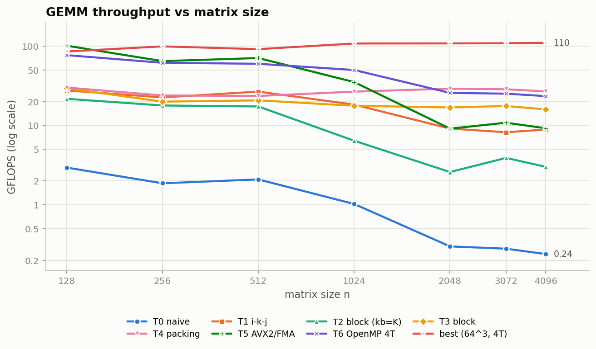
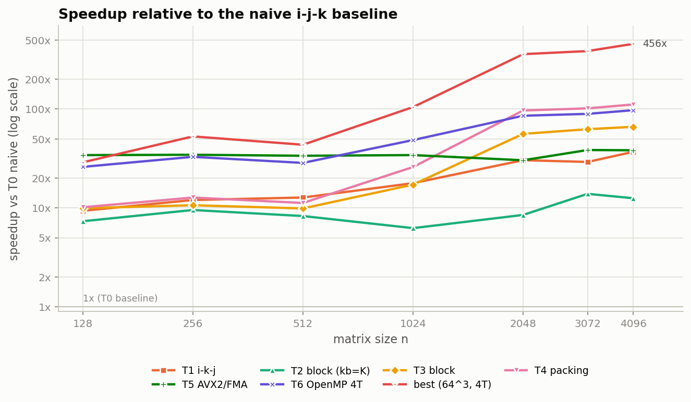
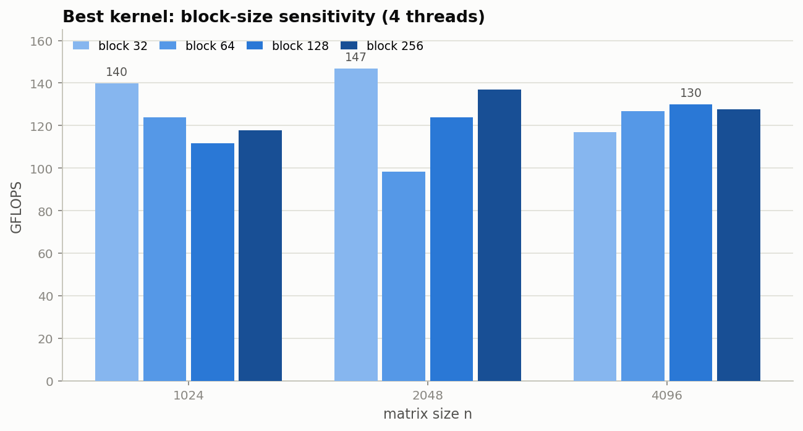
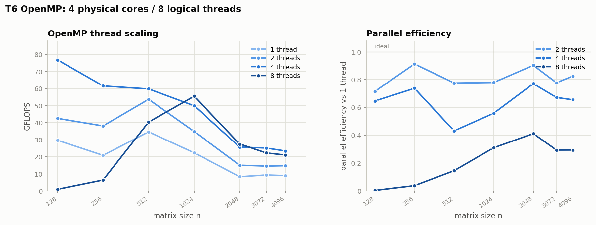
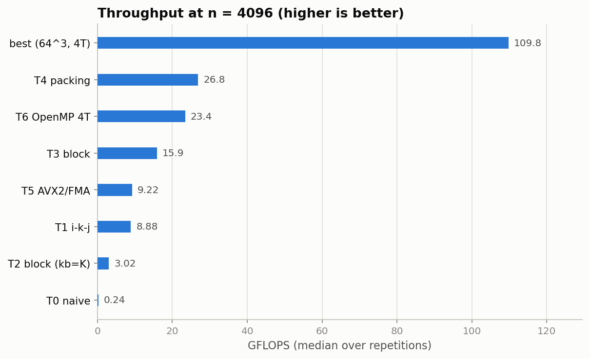

# 基于计算机体系结构技术的矩阵乘法性能优化

## 调研与实验报告

课程：《高级计算机体系结构》

姓名：____________________
学号：____________________
日期：____________________

---

## 摘要

本报告以行优先、FP32 方阵 GEMM 为对象，研究循环重排、缓存分块、数据打包、SIMD 和多线程对矩阵乘法性能的影响。实验在 Intel i5-1155G7、WSL2 和 GCC 11.4 平台上实现 T0–T6 共 7 个变体，并组合出 best，覆盖 n = 128 到 4096 的 7 个规模。

主要结论如下：

- 朴素 i-j-k 基线在大矩阵上受到 B 的跨步访问和缓存缺失限制，n = 4096 时仅 0.24 GFLOPS。
- 仅做 i-k-j 重排即可获得 36.94× 加速，说明访问连续性是首要矛盾；分块只有在超过 L3 后才明显有效。
- 数据打包使 T4 相对 T3 在 n = 1024 到 4096 稳定获得约 1.5–1.7× 增量收益，是分块与 SIMD 微内核之间的桥梁。
- 单独 SIMD 在 n = 128 达到 100.98 GFLOPS，但 n = 4096 降至 9.22 GFLOPS；没有分块和打包时，微内核无法解决大矩阵访存问题。
- 组合实现默认 64³/4T 在 n = 4096 达到 109.77 GFLOPS、相对 T0 456.48×；128³/4T 的本组最好观测值为 130.02 GFLOPS、540.68×。

全部 16 个实验标签、1354 行数据通过正确性阈值和 GFLOPS 一致性检查。最大相对误差为 1.374 × 10⁻⁴，低于 n = 4096 时的经验阈值 4.88 × 10⁻⁴。

## 目录

第一部分：调研报告

1. GEMM 问题与性能模型
2. 体系结构优化技术全景
3. 本实验采用的关键技术
4. 专用架构与实验边界
5. 调研结论与实验取舍

第二部分：实验报告

6. 实验目标与总体设计
7. 实现路线与计时语义
8. 测量协议与正确性验证
9. 单一技术实验结果
10. 矩阵规模与缓存效应
11. 组合优化、消融与参数扫描
12. 性能机制与结果讨论
13. 结论、局限与展望

参考文献
附录 A：数据质量与复现
附录 B：补充数据与图表

---

# 第一部分 调研报告

## 1 GEMM 问题与性能模型

行优先的 GEMM 定义为：

$$
C_{ij}=\sum_{k=0}^{K-1}A_{ik}B_{kj},
\qquad C_{n\times n}=A_{n\times n}B_{n\times n}.
$$

浮点运算量为 2n³。理想情况下，若 A、B、C 都只从主存读取一次，访存量为 4 × 3n² = 12n² 字节，算术强度为：

$$
I=\frac{2n^3}{12n^2}=\frac{n}{6}\ \text{FLOP/Byte}.
$$

Roofline 模型给出上界：

$$
P_{\text{attainable}}\leq\min\left(P_{\text{peak}},I\cdot B_{\text{mem}}\right).
$$

其中 P_peak 为峰值浮点性能，B_mem 为可持续内存带宽。理想算术强度随 n 增长，但三个矩阵的工作集 3n² × 4 = 12n² 字节也同步扩大。当工作集离开 L2/L3 后，重复读取、跨步访问和 TLB 压力会显著降低有效算术强度。

|    n | 三矩阵工作集 | 主要容量区间  |
| ---: | -----------: | ------------- |
|  128 |      192 KiB | L2            |
|  512 |        3 MiB | L3            |
| 1024 |       12 MiB | 超出 8 MiB L3 |
| 4096 |      192 MiB | DRAM/TLB      |

因此，GEMM 优化的核心不是增加乘加语句，而是提高寄存器、缓存和主存之间的数据复用。Hong–Kung 的 I/O 下界 Ω(n³ / √S) 也说明，快速存储容量 S 越大，理论最优访存代价越低 [5]。

## 2 体系结构优化技术全景

| 层面           | 代表技术                         | 主要针对的瓶颈           |
| -------------- | -------------------------------- | ------------------------ |
| 存储层次       | 循环重排、分块、打包、寄存器分块 | 空间局部性、缓存容量     |
| 指令级并行     | SIMD、FMA、多累加器、循环展开    | 单核算力与依赖链         |
| 线程级并行     | OpenMP、行/列块划分、线程亲和    | 单核算力、共享缓存与带宽 |
| 专用架构       | Tensor Core、Intel AMX、ARM SME  | 高吞吐矩阵乘加           |
| 算法与数值     | Strassen、混合精度、稀疏算法     | 运算量、位宽与稀疏性     |
| 工具与自动调优 | BLAS/BLIS、TVM/Ansor、MLIR       | 参数搜索与代码生成       |

高性能 GEMM 的典型结构是“多级分块 → 数据打包 → 寄存器分块微内核 → SIMD/矩阵指令 → 多线程”。这些技术分别作用于不同存储层次，不能相互完全替代 [2][3][4]。

## 3 本实验采用的关键技术

### 3.1 循环重排

行优先矩阵中，i-j-k 的最内层对 k 归约，访问 B[k × N + j] 的步长为 N，空间局部性差。改成 i-k-j 后，最内层对 j 连续访问 B 的行和 C 的行。循环顺序不改变运算量和累加顺序，只改善访存模式。

### 3.2 缓存分块

把 C、A、B 的活动区域限制在缓存容量内，可把跨块复用转化为块内复用。分块参数必须同时考虑缓存容量、相联度、边界开销和 TLB；块过大放不进缓存，块过小则循环和打包开销占比过高 [4]。

### 3.3 数据打包

打包把非连续面板复制到连续、对齐的临时区域，便于顺序读取和 SIMD 载入。若按当前实现，B 面板每个列块打包一次，总流量约为 O(n²)；A 面板会随每个列块重复打包，总流量约为 O(n³ / n_b)。因此总打包流量应写为：

$$
O\left(n^2+\frac{n^3}{n_b}\right).
$$

打包不是免费的，其价值来自一次复制后的多次复用，并与分块、寄存器分块共同作用。

### 3.4 寄存器分块与 SIMD

AVX2 的 256 位寄存器包含 8 个 FP32 lane。8×8 微内核同时保存 8 个累加向量，每次载入 B 的 8 个元素并广播 8 个 A 元素，可把乘加密度从标量提升到向量级。若没有连续面板，跨步载入和寄存器溢出会抵消 SIMD 收益 [18][19]。

### 3.5 多线程

按 C 的行或列块划分任务，可避免线程写冲突。多线程的收益取决于负载均衡、共享 L3、DRAM 带宽和全核频率。物理核数通常比逻辑线程数更能代表计算吞吐上限。

## 4 专用架构与实验边界

NVIDIA Tensor Core、Intel AMX 和 ARM SME 均通过矩阵 tile、fragment 或二维累加器减少指令开销，提高矩阵乘加吞吐 [8][9][10]。Google TPU 的脉动阵列则通过规则数据流提高能效 [13]。

本机是 Tiger Lake 客户端 CPU，支持 AVX2/FMA 和 AVX-512，但没有 AMX、SME 或 NVIDIA GPU，因此这些技术只用于背景讨论，不参与本机加速比。混合精度、FP8、稀疏和 Strassen 同样不属于本次实测范围。

## 5 调研结论与实验取舍

调研得到三点直接启示：

1. 先修复最严重的跨步访问，再处理缓存容量问题。
2. 分块、打包和微内核应组合使用，单项技术的收益受其所针对的瓶颈限制。
3. 多线程受共享缓存和带宽约束，必须与单线程优化一起评估。

据此选择循环重排、T2/T3 分块、数据打包、AVX2/FMA 微内核和 OpenMP 作为实验路线。专用架构和系统级微调保留在展望中。

---

# 第二部分 实验报告

## 6 实验目标与总体设计

实验回答两个问题：

1. 循环重排、分块、打包、SIMD 和多线程分别能带来多少加速，收益如何随矩阵规模变化？
2. 多技术组合的稳定配置是什么，缓存、带宽、线程和测量波动如何限制最终性能？

| 变体 | 技术                                     |
| ---- | ---------------------------------------- |
| T0   | 朴素 i-j-k，基线                         |
| T1   | i-k-j 循环重排                           |
| T2   | 仅 i/j 分块，k_b = K，用于检验不合理分块 |
| T3   | 64³ 三维分块                            |
| T4   | 分块 + A/B 面板打包                      |
| T5   | 8×8 寄存器分块 + AVX2/FMA               |
| T6   | OpenMP 行并行，测试 1/2/4/8 线程         |
| best | 分块 + 打包 + 微内核 + OpenMP            |

主要扫描 n ∈ {128, 256, 512, 1024, 2048, 3072, 4096}。T6 线程扩展与 best 块大小扫描另存为独立数据批次；因此补充扫描组只覆盖部分规模。

## 7 实现路线与计时语义

所有变体使用统一函数接口，参数包括分块大小和线程数。bench 通过函数指针选择变体，负责分配、初始化、双精度参考、计时和 CSV 输出。

统一采用 beta=0 语义。每次调用前由 bench 在计时区外清零 C。T0、T1 直接写 C；T2–T6 和 best 内部使用 C += ...。

需要特别说明：T4 与 best 的 time_s 包含面板打包、临时缓冲区 malloc/free 和 OpenMP 运行开销。主矩阵 A/B/C 的分配、初始化和 C 清零不计时。因此 T4/best 反映的是完整变体调用成本，而不是只包含微内核指令。小矩阵上分配和线程启动开销占比更高，解释结果时必须考虑这一边界。

## 8 测量协议与正确性验证

| 项目     | 配置                                                |
| -------- | --------------------------------------------------- |
| 系统     | WSL2 + Ubuntu 22.04.5                               |
| CPU      | Intel i5-1155G7，4 物理核 / 8 逻辑线程              |
| 缓存     | L1d 48 KiB/核，L2 1.25 MiB/核，L3 8 MiB             |
| 编译器   | GCC 11.4.0                                          |
| 编译选项 | -O3 -march=native -fopenmp -std=gnu11 -Wall -Wextra |

计时使用 CLOCK_MONOTONIC，默认热身 2 次。每次测量只包围一次 GEMM 调用；重复次数自适应，最少 3 次，单次已超过 2 秒时最少 2 次，最多 30 次。报告采用中位数，并保留原始重复数据用于观察分布。

正确性使用双精度参考值。最大绝对误差为：

$$
\mathrm{maxAbsErr}=\max_{i,j}\left|C_{ij}-C_{ij}^{\text{ref}}\right|.
$$

最大相对误差为：

$$
\mathrm{maxRelErr}
=\max_{i,j}\frac{\left|C_{ij}-C_{ij}^{\text{ref}}\right|}
{\max\left(1,\left|C_{ij}^{\text{ref}}\right|\right)}.
$$

验收采用经验阈值：

$$
\mathrm{relErr}\leq n\cdot\mathrm{FLT-EPSILON},\qquad
\mathrm{FLT-EPSILON}\approx1.19\times10^{-7}.
$$

该阈值不是与输入无关的严格最坏误差上界，而是与本实验输入范围和数据规模匹配的经验判据。全部 1354 行数据均通过。

测量限制包括：未采集 PMU 缓存/TLB 计数；WSL 无法读取真实频率和温度；未固定 governor 和绑核；没有 OpenBLAS 对照。缓存和 TLB 分析属于基于工作集与访问模式的机制解释。

## 9 单一技术实验结果

*图 1：各主要变体的 GFLOPS–n 曲线，数据取中位数。*

n = 4096 时的主要结果如下：

| 变体               |      时间 |  GFLOPS |  相对 T0 |
| ------------------ | --------: | ------: | -------: |
| T0 朴素            | 571.525 s |   0.240 |   1.00× |
| T1 i-k-j           |  15.472 s |   8.883 |  36.94× |
| T2 不合理 i/j 分块 |  45.575 s |   3.016 |  12.54× |
| T3 三维分块        |   8.638 s |  15.911 |  66.17× |
| T4 分块 + 打包     |   5.136 s |  26.760 | 111.28× |
| T5 仅 SIMD         |  14.920 s |   9.212 |  38.31× |
| T6 OpenMP 4T       |   5.870 s |  23.415 |  97.37× |
| best 64³/4T       |   1.252 s | 109.773 | 456.48× |

**循环重排。** T1 是所有规模中收益最直接的单步优化。它消除了 B 的最严重跨步访问，但由于没有分块，n ≥ 2048 时仍只剩约 9 GFLOPS。

**负结果。** T2 在所有规模都慢于 T1。其 k_b = K 使 B 面板在地址空间中跨越大范围；虽然 T2 仍比 T0 快，但它采用了比 T1 的顺序扫描更差的访问模式。这说明“分块”不是无条件收益，块参数必须与访问布局匹配。

**分块与打包。** T3 在 n = 1024 与 T1 基本持平，但在 n = 2048/4096 分别达到 T1 的 1.845/1.791 倍。T4 在 n = 1024 到 4096 相对 T3 稳定获得 1.51–1.73 倍增量。连续面板改善了空间局部性，但代价是额外打包和缓冲区管理。

**SIMD。** T5 在 n = 128 达到 100.98 GFLOPS，说明微内核本身有效；但 n = 4096 只有 9.22 GFLOPS。单独 SIMD 无法消除重复扫描和跨步访问。其相对 T0 的加速比仍有 38.31×，这是因为 T0 退化得更严重，不能据此认为 T5 的绝对性能稳定。

**多线程。** T6 4 线程在 n = 4096 相对 T6 单线程为 2.62×，并行效率约 0.66；8 线程为 2.36×，效率约 0.29。4 线程是整体更可靠的选择。

*图 2：各变体相对 T0 的加速比。加速比必须与绝对 GFLOPS 同时解释。*

## 10 矩阵规模与缓存效应

| 规模区间          | 主要现象                    | 主要瓶颈            |
| ----------------- | --------------------------- | ------------------- |
| n ≤ 128          | T5 单线程达到 100.98 GFLOPS | 调用、线程启动和 L2 |
| 256 ≤ n ≤ 512   | best 保持 91–99 GFLOPS     | L2/L3 过渡          |
| 1024 ≤ n ≤ 2048 | T3/T4 开始体现收益          | 超出 L3、TLB 和带宽 |
| n ≥ 3072         | best 维持约 108–110 GFLOPS | DRAM、TLB、共享资源 |

T0 在 n = 1024 时吞吐由 2.09 降至 1.03 GFLOPS，与三矩阵工作集 12 MiB 超过 8 MiB L3 的容量变化一致。T4 在 1024–4096 保持约 27–29 GFLOPS，说明连续面板降低了大矩阵上的跨步惩罚。由于没有 PMU，具体缺失来源只能作为机制解释，不能视为计数器实测。

## 11 组合优化、消融与参数扫描

组合栈按 T0 → T1 → T3 → T4 → best 单线程 → best 4 线程逐层增加。n = 4096 的结果为：

| 阶段    |      时间 |  GFLOPS |  相对 T0 | 相对上一层 |
| ------- | --------: | ------: | -------: | ---------: |
| T0      | 571.525 s |   0.240 |   1.00× |         — |
| T1      |  15.472 s |   8.883 |  36.94× |    36.94× |
| T3      |   8.638 s |  15.911 |  66.17× |    1.791× |
| T4      |   5.136 s |  26.760 | 111.28× |    1.682× |
| best 1T |   2.113 s |   65.05 | 270.45× |    2.430× |
| best 4T |   1.252 s | 109.773 | 456.48× |    1.688× |

组合结果显示：循环重排解决最严重的访问问题，分块和打包解决容量与布局问题，微内核提高单核计算密度，多线程进一步利用物理核。4 线程相对于 best 单线程只有 1.56–1.89×，说明共享资源已成为主要限制。

分块扫描结果如下：

|    n |             32³ |   64³ |            128³ |  256³ | 本组最好 |
| ---: | ---------------: | -----: | ---------------: | -----: | -------: |
| 1024 | **139.92** | 123.87 |           111.67 | 117.70 |     32³ |
| 2048 | **146.80** |  98.33 |           123.76 | 136.88 |     32³ |
| 4096 |           117.00 | 126.86 | **130.02** | 127.69 |    128³ |

*图 3：best 在 4 线程下对立方块大小的敏感性。*

中小规模适合 32³，大规模适合 128³。没有全规模统一的最优块大小。

各规模的最好观测配置为：

|    n | 最好观测配置  | GFLOPS |  相对 T0 |
| ---: | ------------- | -----: | -------: |
|  128 | T5 单线程     | 100.98 |  34.22× |
|  256 | best 64³/4T  |  98.99 |  52.90× |
|  512 | best 64³/4T  |  91.31 |  43.58× |
| 1024 | best 32³/4T  | 139.92 | 136.20× |
| 2048 | best 32³/4T  | 146.80 | 488.75× |
| 3072 | best 64³/4T  | 108.40 | 385.76× |
| 4096 | best 128³/4T | 130.02 | 540.68× |

如果只选择一个全规模默认配置，64³/4T 的性能包络最稳健：小矩阵不是最快，但没有明显塌陷。128³/4T 在 n = 4096 的 540.68× 是本组最好观测值，不应解释为稳定常数。

## 12 性能机制与结果讨论

**算力上界。** 按 4 核、每周期 2 次 8-lane FMA、每 FMA 2 FLOP 估算，峰值约为 128 × f GFLOPS。2.5 GHz 时约 320 GFLOPS。实测组合配置为 109–147 GFLOPS，处于估算上界的 34%–46%，说明仍有优化空间，也说明峰值估算本身受实际频率和指令组合影响。

**缓存与布局。** T0 的 B 访问步长随 n 增长，空间局部性最差；T1 改善连续访问；T3 把活动块压入缓存；T4 用连续面板进一步降低跨步。T5 没有分块和打包，因此在大矩阵上退化。这些结果与访问模式和容量转折一致，但缺少 PMU 计数验证。

**TLB。** 大规模矩阵的跨页访问会增加页表压力。T2 的 k_b = K 配置在地址空间上分散访问，是观察跨步和 TLB 风险的典型负例。由于未采集 dTLB 缺失，仍不能把性能差异完全归因于 TLB。

**线程扩展。** 4 线程利用 4 个物理核，整体效率为 0.66–0.77；8 线程共享 4 个物理核，效率降至 0.29–0.41。小矩阵还存在明显的线程启动和测量噪声，8 线程 n=128 的最小、中位、最大时间分别约为 0.190、4.280、20.009 ms，离散度很大。因此只能认为该配置在本批次中不稳定且收益很差，不能把单一倍数解释为稳定硬件常数。

*图 4：T6 的 OpenMP 线程扩展与并行效率。*

**测量波动。** 大矩阵多数配置的批次间差异约为 5%–30%，小矩阵和 8 线程出现更大的离群值。首次 T6 4T n = 4096 曾出现约 10.18 s，重跑中位数为 5.87 s；报告采用重跑数据，但保留异常记录，避免把单次异常解释为算法差异。

## 13 结论、局限与展望

### 13.1 结论

1. 循环重排是收益最高的第一步，直接解决了朴素实现的最严重跨步访问。
2. 分块不是无条件有效。T2 的负结果说明块参数必须匹配缓存和访问布局。
3. 打包为分块和 SIMD 提供连续数据，是组合路径中的关键连接环节。
4. SIMD 提高单核计算密度，但必须与分块、打包结合才能稳定服务大矩阵。
5. OpenMP 4 线程在本平台更可靠；8 线程受共享资源和测量波动限制。
6. best 64³/4T 是全规模默认选择，n = 4096 达到 109.77 GFLOPS、456.48×；128³/4T 的最好观测值为 130.02 GFLOPS、540.68×。

### 13.2 局限与展望

- 没有 PMU 缓存/TLB 计数，缓存与 TLB 讨论属于机制分析。
- 未固定频率和绑核，小矩阵测量存在明显波动。
- 没有 OpenBLAS 对照，不能据此评价与工业库的差距。
- 只测方阵 FP32，未覆盖矩形形状、低精度、稀疏和 AVX-512/AMX/GPU。
- 后续工作包括工作区预分配、线程亲和、软件预取、非临时写、大页和 OpenBLAS 对照。

---

## 参考文献

[1] Williams S., Waterman A., Patterson D. Roofline: An Insightful Visual Performance Model for Multicore Architectures. *Communications of the ACM*, 52(4): 65–76, 2009.

[2] Goto K., van de Geijn R. A. Anatomy of High-Performance Matrix Multiplication. *ACM TOMS*, 34(3), Article 12, 2008.

[3] Van Zee F. G., van de Geijn R. A. BLIS: A Framework for Rapidly Instantiating BLAS Functionality. *ACM TOMS*, 41(3), Article 14, 2015.

[4] Lam M. D., Rothberg E. E., Wolf M. E. The Cache Performance and Optimizations of Blocked Algorithms. *ASPLOS-IV*, 1991.

[5] Hong J.-W., Kung H. T. I/O Complexity: The Red-Blue Pebble Game. *STOC*, 1981.

[6] Whaley R. C., Petitet A., Dongarra J. J. Automated Empirical Optimizations of Software and the ATLAS Project. *Parallel Computing*, 27(1–2), 2001.

[7] Blackford L. S., et al. An Updated Set of Basic Linear Algebra Subprograms. *ACM TOMS*, 28(2), 2002.

[8] Intel Corporation. *Intel Architecture Instruction Set Extensions Programming Reference*: Intel AMX.

[9] Arm. *SME Programmer's Guide*; MLIR ArmSME Dialect.

[10] NVIDIA. *CUTLASS Documentation: Tensor Core GEMM*.

[11] Strassen V. Gaussian Elimination is Not Optimal. *Numerische Mathematik*, 13, 1969.

[12] Zheng L., et al. Ansor: Generating High-Performance Tensor Programs for Deep Learning. *OSDI*, 2020.

[13] Jouppi N. P., et al. In-Datacenter Performance Analysis of a Tensor Processing Unit. *ISCA*, 2017.

[14] Gao J., et al. A Systematic Survey of General Sparse Matrix-Matrix Multiplication. *ACM Computing Surveys*, 2023.

[15] Xiao J., et al. A Survey of Accelerating Parallel Sparse Linear Algebra. *ACM Computing Surveys*, 2024.

[16] Chen T., et al. TVM: An Automated End-to-End Optimizing Compiler for Deep Learning. *OSDI*, 2018.

[17] Hennessy J. L., Patterson D. A. *Computer Architecture: A Quantitative Approach*, 6th ed., 2019.

[18] Intel Corporation. *Intel 64 and IA-32 Architectures Optimization Reference Manual*, 2023.

[19] Fog A. *Optimizing Subroutines in Assembly Language*, 2023.

[20] OpenBLAS Project; BLIS Project documentation.

---

## 附录 A 数据质量与复现

本地汇总文件 gemm-lab/data/final.csv 包含 1354 行、16 个实验标签（CSV 不随仓库上传）。T2/T3 的原始 variant 都是 block，不同 T6 批次都是 omp，因此由 merge_data.py 增加 label 和 source_file 后区分。

校验内容包括：

- 必需字段完整；
- 矩阵规模、时间和误差数值合法；
- 每行满足 K × FLT_EPSILON 经验阈值；
- 每行 GFLOPS 与 2MNK / t 的误差不超过 2%；
- 所有预期实验标签均存在。

校验结果：最大相对误差 1.374 × 10⁻⁴，最大阈值占比 0.303，全部检查通过。补充扫描中 best_t1 和块大小扫描只覆盖 1024–4096，不影响主要 T0–T6 的 128–4096 对比。

基本复现命令：

| 步骤 | 操作                                             |
| ---- | ------------------------------------------------ |
| 1    | 进入 gemm-lab 目录                               |
| 2    | 执行 make 编译                                   |
| 3    | 执行 bench，选择 best、n=1024、重复 3 次、4 线程 |
| 4    | 执行 check_final.py 校验数据                     |
| 5    | 执行 plot_final.py 生成图表                      |

若要从零重建全部数据，需要另外运行 T6 的 1/2/4/8 线程实验、best 单线程实验和 32/64/128/256 分块扫描。run_all.sh 只负责基础 7 变体扫描，不能单独生成全部补充数据。

## 附录 B 补充数据与图表

*图 5：n = 4096 时主要配置的吞吐对比。*

完整重复测量和原始 CSV 保存在本地；绘图脚本和 C 源码随仓库提交。报告中的图表由 plot_final.py 从数据生成，未手工修改测量值。
